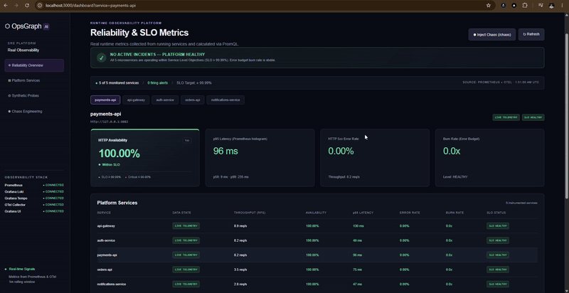
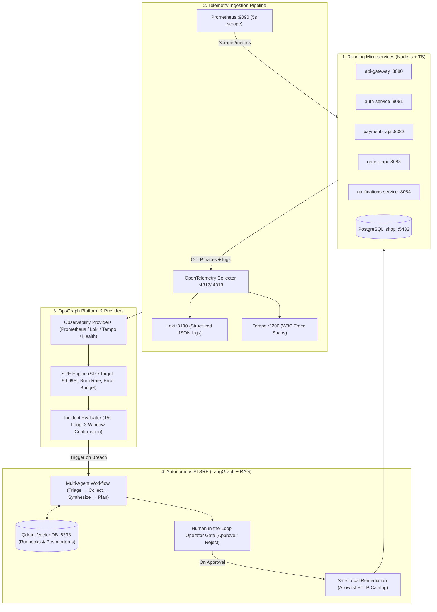

# OpsGraph AI — Real Observability & Autonomous SRE Platform

OpsGraph AI is an AI-native Site Reliability Engineering (SRE) and real-time observability platform. The platform ingests authentic telemetry from running services, calculates key reliability indicators (SLI/SLO, Availability, p95 latency, Error Rate, Error Budget Burn Rate), correlates structured logs and distributed traces, and enables controlled fault injection (Chaos Engineering).

---

## 🎬 Live Platform Walkthrough

<p align="center">
  <a href="https://github.com/foreigntechnologies/OpsGraphAI/raw/main/assets/demo.mp4">
    
  </a>
</p>

▶️ **[Watch the demo (MP4, 24s)](https://github.com/foreigntechnologies/OpsGraphAI/raw/main/assets/demo.mp4)**

> **Demo (24s):** Live reliability dashboard streaming real Prometheus metrics across the 5 microservices (`payments-api`, `api-gateway`, `auth-service`, `orders-api`, `notifications-service`), the observability stack health (Prometheus, Grafana Loki, Grafana Tempo, OTel Collector, Grafana UI), and the Chaos Engineering controller used to inject real faults.

---

## 🌟 Core Pillars

1. **Authentic Runtime Telemetry:**
   - Metrics scraped via **Prometheus** and calculated across sliding windows using PromQL.
   - Distributed traces with W3C TraceContext propagated via **OpenTelemetry SDK** and visualized in **Tempo**.
   - Structured logs correlated via `traceId` and `spanId` using **Loki**.
   - Zero synthetic mocks or fake telemetry in production mode: when traffic is absent or an integration is offline, the platform transparently reports `NO_DATA` or `DISCONNECTED`.

2. **Real Microservices Topology:**
   - `api-gateway` (Port 8080): Ingress routing and orchestration.
   - `auth-service` (Port 8081): JWT token issuance and verification.
   - `payments-api` (Port 8082): Transactional charge processing backed by **PostgreSQL** (`shop`).
   - `orders-api` (Port 8083): Order management with downstream calls to `payments-api` and strict client timeout (1500ms).
   - `notifications-service` (Port 8084): Checkout notifications.
   - `traffic-generator`: Continuous synthetic traffic generator with realistic workload profiles and backpressure.

3. **Chaos Engineering & Safety:**
   - In-memory fault injections with automatic **Safety TTL** (5 to 30 min) and emergency **RESET ALL CHAOS**:
     - *PostgreSQL Latency:* Executes real `SELECT pg_sleep()` during payment transactions.
     - *HTTP 500 Error Spike:* Middleware intercepts business requests and records exceptions into OTel spans.
     - *Dependency Timeout:* Delays payment processing to exceed `orders-api` client timeout, triggering HTTP 504.

4. **Executive Presentation Mode (`/demo`):**
   - High-impact presentation mode designed for technical demos, portfolio presentations, and architectural walkthroughs.
   - Deterministic 9-step interactive flow: Healthy Baseline ➔ Deployment ➔ Telemetry Degradation & SLO Breach ➔ Multi-Agent Triage (LangGraph) ➔ Traces & Logs Investigation ➔ Root Cause Synthesis ➔ Human-in-the-Loop Approval ➔ Automated Remediation ➔ Postmortem & SLO Restoration.

---

## 🔄 Real Observability Flow



1. **Instrumented Microservices:** Spans, metrics, and structured logs with W3C `traceparent` propagation are emitted by all services.
2. **Telemetry Ingestion:** Prometheus pulls `/metrics` at high frequency; OTel Collector forwards traces to Tempo and structured logs with `traceId` to Loki.
3. **Observability Providers & SRE Engine:** Aggregates real telemetry across sliding windows, calculates Four Nines compliance (≥ 99.99%), and detects anomalies.
4. **LangGraph Multi-Agent Orchestration:** Evaluates breach severity, executes parallel observability tools, retrieves matching runbooks from Qdrant, synthesizes root cause hypotheses, and presents safe remediation for human operator approval.

---

## 🚀 Getting Started

### Prerequisites
- **Node.js 22.12+** and **npm**
- (Optional, for full observability stack): **Docker Desktop**

### 1. Launching Microservices and Web Application

```bash
# Install dependencies
npm install

# Initialize SQLite database and migrations
npm run setup

# Ingest operational runbooks into Qdrant vector database
npm --workspace=@opsgraph/api run rag:index

# Option A: Start entire platform (5 microservices + traffic generator + API + Web)
npm run dev:all

# Option B: Run only the 5 background microservices
npm run services:dev

# Option C: Run only the OpsGraph API (Port 4000) and Web Frontend (Port 3000)
npm run dev
```

### 2. Available Routes & Panels

| Component | URL | Description |
| :--- | :--- | :--- |
| **Reliability Dashboard** | http://localhost:3000/dashboard | Real-time SRE overview, 99.99% SLO status, and microservices table |
| **Incident Investigation** | http://localhost:3000/incidents/[id] | LangGraph multi-agent workflow, root cause, real trace waterfall, logs & approval |
| **Service Deep Dive** | http://localhost:3000/services/[name] | Latency p50/p95/p99 breakdown, live Loki logs, and Tempo distributed traces |
| **Chaos Engineering Controller** | http://localhost:3000/chaos | Fault injection with safety TTL and global reset |
| **Executive Presentation Mode** | http://localhost:3000/demo | Interactive animated 20-30s presentation storyboard |
| **Yoga GraphQL API** | http://127.0.0.1:4000/graphql | Interactive GraphiQL Explorer & Subscriptions |
| **API Health Check** | http://127.0.0.1:4000/health | Readiness probe and SQLite check |

---

## 🛠️ Infrastructure Stack (Docker Compose)

To spin up the local observability collectors:

```bash
docker compose up -d
```

- **Prometheus:** `http://localhost:9090` (scrapes `/metrics` every 5s from all services)
- **Grafana:** `http://localhost:3001` (credentials: `admin` / `admin`, provisioned with `Service Reliability` and `OpsGraph AI Platform` dashboards)
- **Tempo:** `http://localhost:3200` (OTLP Tracing)
- **Loki:** `http://localhost:3100` (Structured Logs)
- **OTel Collector:** `http://localhost:4317` (gRPC) & `http://localhost:4318` (HTTP)
- **PostgreSQL:** `localhost:5432` (`shop` database)

---

## 📊 GraphQL Queries

```graphql
# Query reliability metrics and service health
query RealObservability {
  observabilityHealth {
    prometheus { status latencyMs }
    loki { status latencyMs }
    tempo { status latencyMs }
    collector { status latencyMs }
    grafana { status latencyMs }
  }
  servicesReliability {
    service
    state
    availability
    latencyP95
    errorRate
    burnRate
    sloStatus
  }
  servicesHealth {
    service
    url
    status
    version
  }
  chaosState {
    enabled
    activeScenarios {
      service
      type
      enabled
      expiresAt
    }
  }
}

# Inject database latency fault
mutation TriggerDbChaos {
  enableChaos(
    service: "payments-api"
    scenario: "DATABASE_LATENCY"
    paramsJson: "{\"delayMs\": 1500}"
    ttlMinutes: 10
  )
}

# Immediately restore healthy baseline across all services
mutation ResetChaos {
  resetAllChaos
}
```

---

## 🧪 Testing and Code Validation

```bash
# Run full Vitest test suite
npm test

# Strict TypeScript type checking across all 10 workspaces
npm run typecheck

# Build Next.js web application for production
npm --workspace=@opsgraph/web run build
```

---

## 📚 Knowledge Base & Runbooks (RAG)

Operational runbooks and architecture docs used by AI agents are stored in `knowledge/`:
- `knowledge/runbooks/database-latency.md`: PostgreSQL lock contention and slow query diagnostics.
- `knowledge/runbooks/error-spike.md`: Mitigation of HTTP 5xx error spikes.
- `knowledge/runbooks/dependency-timeout.md`: Diagnosing cascading downstream timeouts (orders ➔ payments).
- `knowledge/architecture/services.md`: Microservices topology, ports, and dependencies.
