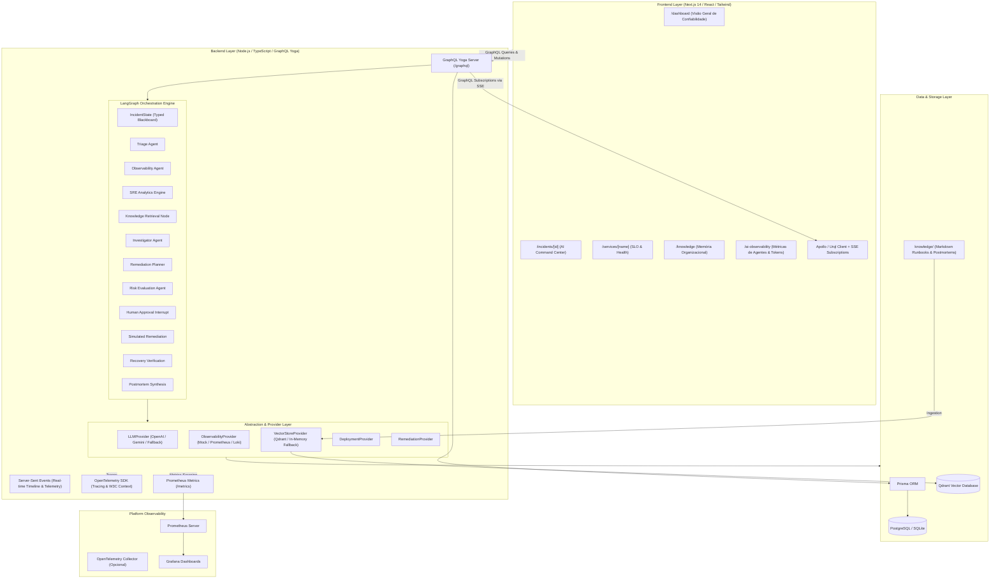
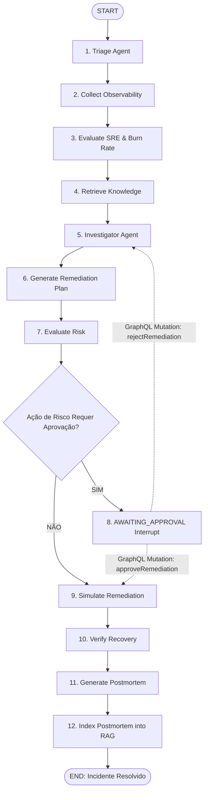

# OpsGraph AI — Plano Completo de Implementação
## Plataforma de SRE Agêntico e Resposta a Incidentes com IA

> **Status:** VALIDADO COM CORREÇÕES — FASES 1–3 IMPLEMENTADAS  
> **Documento:** Plano Mestre de Arquitetura e Engenharia de Software  
> **Versão:** 2.1.0  
> **Stack Principal:** TypeScript (Monorepo), Next.js 16, GraphQL Yoga, LangGraph.js, LangChain.js, Qdrant, Prisma ORM 7, OpenTelemetry, Prometheus, Grafana.

> **Revisão de engenharia (17/10/2026):** as [correções e decisões de validação](docs/plan-validation.md) prevalecem sobre os exemplos originais abaixo, especialmente fórmulas SRE, janelas de telemetria, migração de banco, contagem dos nós e aprovação humana. Consulte o [README](README.md) para executar a entrega das fases 1–3. As fases 4–10 permanecem pendentes.

---

## Sumário Executivo

O **OpsGraph AI** é uma plataforma de engenharia de confiabilidade de sites (SRE) e resposta autônoma a incidentes nativa de IA, modelada sob a figura de um **AI Incident Commander**. Diferente de chatbots tradicionais ou dashboards analíticos passivos, o OpsGraph AI orquestra múltiplos agentes inteligentes de forma orientada a estados (Stateful Multi-Agent Orchestration via LangGraph), correlaciona telemetria de produção (métricas, logs estruturados, distributed tracing e histórico de deployments), calcula o consumo acelerado de error budgets (burn rate), recupera memória operacional via RAG (runbooks e postmortems históricos), gera e ranqueia hipóteses de causa-raiz, avalia o risco operacional de remediações, pausa para aprovação humana obrigatória (*Human-in-the-Loop*), executa remediação simulada com rollback e monitoramento de recuperação de SLO, e gera automaticamente um postmortem completo que é reindexado no banco vetorial como aprendizado contínuo.

```
┌────────────────────────────────────────────────────────────────────────────────────────┐
│                        OpsGraph AI — Ciclo de Memória Organizacional                   │
└───────────────────────────────────────────┬────────────────────────────────────────────┘
                                            │
                                            ▼
           Incidente de Produção ──► Investigação Multi-Agente ──► Human-in-the-Loop
                    ▲                                                     │
                    │                                                     ▼
           RAG Mais Inteligente ◄── Base Vetorial ◄── Postmortem ◄── Remediação Simulada
```

---

## 1. Visão Geral da Arquitetura do Sistema

### 1.1 Diagrama Geral de Componentes (Mermaid)



### 1.2 Princípios Arquiteturais Centrais
1. **TypeScript End-to-End**: Compartilhamento estrito de tipos e esquemas Zod entre frontend, backend e agentes via `packages/shared`.
2. **GraphQL-First**: Todas as operações de leitura, mutação e streaming em tempo real utilizam GraphQL. Nenhuma rota ad-hoc REST é permitida para lógica de negócio.
3. **Resiliência e Zero-Dependency Local**: O sistema funciona 100% de ponta a ponta sem exigir que o Docker ou chaves pagas de API estejam ativos:
   - Banco de dados: SQLite por padrão via Prisma, facilmente comutável para PostgreSQL via variável `DATABASE_URL`.
   - Vector Store: Qdrant client com fallback automático para busca vetorial cosseno em memória se o daemon do Qdrant não estiver respondendo.
   - LLM: `LLMProvider` modular com suporte a OpenAI (`gpt-4o`), Google Gemini (`gemini-1.5-pro` / `gemini-2.0-flash`) e Mock Determinístico de alta fidelidade para apresentações e CI/CD.
4. **Human-in-the-Loop Nativo**: Ações que alteram ambientes de produção (como rollbacks e ajustes de pool) interrompem o fluxo do LangGraph e aguardam autorização humana via mutação GraphQL `approveRemediation`.
5. **Observabilidade Dupla**:
   - O OpsGraph AI observa a infraestrutura simulada (SLO, métricas p95, traces anômalos de 4.25s, logs de esgotamento de pool).
   - O próprio OpsGraph AI é instrumentado com OpenTelemetry (spans para cada nó do grafo, chamadas LLM e queries vetoriais) e métricas Prometheus em `/metrics`.

---

## 2. Estrutura Completa de Diretórios do Monorepo

```
opsgraph-ai/
├── apps/
│   ├── web/                                     # Aplicação Next.js 14
│   │   ├── src/
│   │   │   ├── app/
│   │   │   │   ├── layout.tsx                   # Layout global com Command Center Header e Theme
│   │   │   │   ├── page.tsx                     # Redirect para /dashboard
│   │   │   │   ├── dashboard/
│   │   │   │   │   └── page.tsx                 # Overview operacional, MTTR, alertas e at-risk services
│   │   │   │   ├── incidents/
│   │   │   │   │   ├── page.tsx                 # Catálogo geral de incidentes com filtros
│   │   │   │   │   └── [id]/
│   │   │   │   │       ├── page.tsx             # Hero Command Center do Incidente (página principal)
│   │   │   │   │       └── report/
│   │   │   │   │           └── page.tsx         # Relatório compartilhável para screenshot/PDF (seção 12.6)
│   │   │   │   ├── services/
│   │   │   │   │   ├── page.tsx                 # Listagem de serviços
│   │   │   │   │   └── [name]/
│   │   │   │   │       └── page.tsx             # SLOs, métricas e histórico do serviço
│   │   │   │   ├── knowledge/
│   │   │   │   │   └── page.tsx                 # Explorador de Runbooks e Postmortems com busca semântica
│   │   │   │   ├── ai-observability/
│   │   │   │   │   └── page.tsx                 # Painel de métricas de IA (tokens, custos, latência de agentes)
│   │   │   │   └── demo/
│   │   │   │       └── page.tsx                 # Modo apresentação para LinkedIn / portfólio (seção 12.1)
│   │   │   ├── components/
│   │   │   │   ├── command-center/
│   │   │   │   │   ├── IncidentHeroRibbon.tsx   # Header com SEV-2, status, duração e badges
│   │   │   │   │   ├── ReliabilityCard.tsx      # Availability, p95, error rate, error budget e 8.1x burn rate
│   │   │   │   │   ├── AgentWorkflowStepper.tsx # Visualizador de nós do LangGraph (Triage -> Obs -> SRE...)
│   │   │   │   │   ├── LiveTimeline.tsx         # Feed de eventos com timestamps e status dos agentes
│   │   │   │   │   ├── HypothesesMatrix.tsx     # Hipóteses ranqueadas com barras de confiança e evidências
│   │   │   │   │   ├── TraceWaterfall.tsx       # Cascata distribuída destacando span anômalo de 4.25s
│   │   │   │   │   ├── LogViewer.tsx            # Console de logs com filtros ERROR, WARN, INFO
│   │   │   │   │   ├── RemediationActionCard.tsx# Ação recomendada, score de risco e botões Approve/Reject
│   │   │   │   │   ├── TelemetryRecoveryChart.tsx# Gráfico de linha interativo (Recharts) com recuperação
│   │   │   │   │   ├── AIExecutionTrace.tsx     # Spans e métricas da execução do LangGraph
│   │   │   │   │   └── PostmortemModal.tsx      # Modal / visualizador de postmortem com badge RAG
│   │   │   │   ├── agent/                       # Compartilhados entre /incidents/[id], /demo e /report
│   │   │   │   │   ├── LiveAgentGraph.tsx       # Grafo SVG animado dos 10 nós do LangGraph (seção 12.3)
│   │   │   │   │   ├── InvestigationSummary.tsx # Resumo operacional estruturado, sem chain-of-thought (seção 12.4)
│   │   │   │   │   └── EngineeringMetricsPanel.tsx # Painel "AI EXECUTION" (seção 12.5)
│   │   │   │   ├── demo/
│   │   │   │   │   ├── DemoStage.tsx            # Layout e composição das 11 etapas
│   │   │   │   │   ├── DemoControls.tsx         # Play/Pause/Reset/Velocidade/Show Architecture
│   │   │   │   │   ├── ServiceHealthPanel.tsx   # Métricas animadas (p95, erro, disponibilidade, burn rate)
│   │   │   │   │   ├── DeploymentEvent.tsx      # Evento "DEPLOYMENT payments-api v2.18.3"
│   │   │   │   │   ├── SloBreachBanner.tsx      # "SLO BREACH DETECTED"
│   │   │   │   │   ├── ToolActivityFeed.tsx     # Uso de ferramentas em tempo real
│   │   │   │   │   ├── EvidencePanel.tsx        # "Signals correlated"
│   │   │   │   │   ├── RootCauseReveal.tsx      # Card "ROOT CAUSE IDENTIFIED"
│   │   │   │   │   ├── SreImpactCard.tsx        # "SLO STATUS: BREACHED"
│   │   │   │   │   ├── RecommendationCard.tsx   # "AI RECOMMENDATION" + Approve/Reject
│   │   │   │   │   ├── ResolvedSummary.tsx      # "INCIDENT RESOLVED"
│   │   │   │   │   └── ArchitectureOverlay.tsx  # Toggle "SHOW ARCHITECTURE" (seção 12.2)
│   │   │   │   ├── report/
│   │   │   │   │   ├── ReportHeader.tsx
│   │   │   │   │   ├── ReportImpactStrip.tsx    # Antes / pico / depois
│   │   │   │   │   └── ReportSection.tsx
│   │   │   │   ├── common/
│   │   │   │   │   ├── Navbar.tsx               # Barra superior com botões "Start Demo" e "Reset Demo"
│   │   │   │   │   ├── Sidebar.tsx              # Navegação lateral
│   │   │   │   │   ├── MetricCard.tsx           # Cartão estilizado com badge de status
│   │   │   │   │   └── Badge.tsx                # Badges de severidade e status
│   │   │   │   └── providers/
│   │   │   │       └── GraphQLProvider.tsx      # Client GraphQL Yoga com suporte a SSE
│   │   │   ├── lib/
│   │   │   │   ├── graphql-client.ts            # Client HTTP + SSE Subscription handler
│   │   │   │   ├── queries.ts                   # Queries, Mutations e Subscriptions GraphQL em string/AST
│   │   │   │   ├── utils.ts                     # Formatadores de data, duração, porcentagem e classes Tailwind
│   │   │   │   ├── demo/
│   │   │   │   │   ├── demo-script.ts           # Keyframes determinísticos (dados vêm de packages/shared/scenario)
│   │   │   │   │   └── demo-reducer.ts          # Máquina de estados pura e testável
│   │   │   │   └── hooks/
│   │   │   │       ├── useDemoPlayer.ts         # Relógio, play/pause, velocidade, autoplay
│   │   │   │       └── useAnimatedNumber.ts     # Interpolação numérica com requestAnimationFrame
│   │   │   └── types/                           # Tipos específicos do frontend
│   │   ├── public/                              # Ícones e assets estáticos
│   │   ├── package.json
│   │   ├── tailwind.config.ts                   # Paleta customizada dark command center
│   │   ├── postcss.config.js
│   │   └── tsconfig.json
│   │
│   └── api/                                     # Backend Node.js / GraphQL Yoga
│       ├── prisma/
│       │   ├── schema.prisma                    # Modelagem completa do domínio
│       │   └── seed.ts                          # Carga inicial (serviços, incidentes históricos, baseline)
│       ├── src/
│       │   ├── index.ts                         # Inicialização do servidor, Yoga, OTel e rota /metrics
│       │   ├── config.ts                        # Leitura e validação de variáveis de ambiente com Zod
│       │   ├── graphql/
│       │   │   ├── schema/
│       │   │   │   ├── typeDefs.ts              # Definição do schema GraphQL (SDL completo)
│       │   │   │   └── index.ts
│       │   │   ├── resolvers/
│       │   │   │   ├── incident.resolver.ts     # Query incident, incidents, timeline, aiPlatformMetrics
│       │   │   │   ├── service.resolver.ts      # Query service, services
│       │   │   │   ├── mutation.resolver.ts     # create, startInvestigation, approve, reject, reset
│       │   │   │   ├── subscription.resolver.ts # incidentTimelineUpdated, telemetryUpdated, etc.
│       │   │   │   └── index.ts
│       │   │   └── pubsub.ts                    # EventEmitter tipado para SSE / Subscriptions
│       │   ├── graph/                           # Orquestração com LangGraph
│       │   │   ├── incident.state.ts            # Interface e StateDefinition do LangGraph
│       │   │   ├── incident.graph.ts            # Construção do StateGraph, edges, condicionais e interrupts
│       │   │   └── nodes/
│       │   │       ├── triage.node.ts           # Nó de triagem e classificação
│       │   │       ├── observability.node.ts    # Nó de coleta paralela de métricas, logs, traces e deploys
│       │   │       ├── sre.node.ts              # Nó de avaliação de SLIs, SLOs e burn rate
│       │   │       ├── knowledge.node.ts        # Nó de busca RAG na base vetorial
│       │   │       ├── investigator.node.ts     # Nó de hipóteses e correlação de causa-raiz
│       │   │       ├── planner.node.ts          # Nó de geração do plano de remediação
│       │   │       ├── risk.node.ts             # Nó de avaliação de risco do plano
│       │   │       ├── approval.node.ts         # Nó de interrupt / espera de aprovação humana
│       │   │       ├── remediation.node.ts      # Nó de execução simulada do rollback
│       │   │       ├── recovery.node.ts         # Nó de verificação da recuperação de métricas
│       │   │       └── postmortem.node.ts       # Nó de geração e indexação do postmortem
│       │   ├── agents/                          # Definição dos prompts e schemas de agentes
│       │   │   ├── triage.agent.ts
│       │   │   ├── observability.agent.ts
│       │   │   ├── investigator.agent.ts
│       │   │   ├── sre.agent.ts
│       │   │   ├── planner.agent.ts
│       │   │   ├── risk.agent.ts
│       │   │   └── postmortem.agent.ts
│       │   ├── tools/                           # Ferramentas dos agentes
│       │   │   ├── metrics.tool.ts              # getServiceMetrics()
│       │   │   ├── logs.tool.ts                 # getRecentLogs()
│       │   │   ├── traces.tool.ts               # getServiceTraces()
│       │   │   ├── deployments.tool.ts          # getRecentDeployments()
│       │   │   ├── slo.tool.ts                  # getServiceSLO()
│       │   │   └── knowledge.tool.ts            # queryKnowledgeBase()
│       │   ├── providers/                       # Camada de abstração de provedores
│       │   │   ├── llm/
│       │   │   │   ├── llm.provider.ts          # Interface LLMProvider
│       │   │   │   ├── openai.provider.ts       # Implementação OpenAI
│       │   │   │   ├── gemini.provider.ts       # Implementação Google Gemini
│       │   │   │   └── mock.provider.ts         # Provedor determinístico para offline/demo
│       │   │   ├── observability/
│       │   │   │   ├── observability.provider.ts# Interface ObservabilityProvider
│       │   │   │   └── mock.observability.ts    # Implementação com dados realistas do payments-api
│       │   │   └── vectorstore/
│       │   │       ├── vectorstore.provider.ts  # Interface VectorStoreProvider
│       │   │       ├── qdrant.provider.ts       # Implementação Qdrant
│       │   │       └── memory.provider.ts       # Fallback em memória com embeddings simples
│       │   ├── rag/                             # Mecanismo de RAG
│       │   │   ├── ingestion.ts                 # Leitor de markdown, chunking recursivo e embedding
│       │   │   ├── retriever.ts                 # Busca semântica e re-ranking por similaridade
│       │   │   └── embeddings.ts                # Provedor de embeddings
│       │   ├── observability/                   # OpenTelemetry e Prometheus
│       │   │   ├── telemetry.ts                 # Inicialização do OTel NodeSDK
│       │   │   ├── metrics.ts                   # Registro de métricas Prometheus (prom-client)
│       │   │   ├── tracer.ts                    # Helper para criação de spans com correlação de IDs
│       │   │   └── logger.ts                    # Logger estruturado (JSON com incidentId e traceId)
│       │   ├── services/                        # Regras de negócio e orquestração
│       │   │   ├── incident.service.ts
│       │   │   ├── service.service.ts
│       │   │   ├── knowledge.service.ts
│       │   │   └── demo.service.ts              # Controle do cenário de demonstração
│       │   └── repositories/                    # Acesso a dados via Prisma
│       │       ├── incident.repository.ts
│       │       └── service.repository.ts
│       ├── package.json
│       └── tsconfig.json
│
├── packages/
│   └── shared/                                  # Pacote compartilhado
│       ├── src/
│       │   ├── schemas/                         # Schemas Zod para saídas estruturadas dos agentes
│       │   │   ├── triage.schema.ts
│       │   │   ├── hypothesis.schema.ts
│       │   │   ├── remediation.schema.ts
│       │   │   ├── risk.schema.ts
│       │   │   └── postmortem.schema.ts
│       │   ├── sre/                             # Funções puras de cálculo de SRE
│       │   │   ├── availability.ts
│       │   │   ├── error-budget.ts
│       │   │   ├── burn-rate.ts
│       │   │   └── calculations.test.ts
│       │   ├── scenario/
│       │   │   └── payments-latency.ts          # Fonte única de verdade do cenário (backend mock + /demo)
│       │   ├── types/                           # Interfaces e tipos compartilhados
│       │   │   ├── incident.ts
│       │   │   ├── telemetry.ts
│       │   │   ├── agent.ts
│       │   │   └── sre.ts
│       │   └── index.ts
│       ├── package.json
│       └── tsconfig.json
│
├── knowledge/                                   # Base de conhecimento Markdown
│   ├── runbooks/
│   │   ├── database-connection-pool.md          # Procedimentos para exaustão de pool
│   │   ├── payment-latency.md                   # Diagnóstico de lentidão no gateway de pagamentos
│   │   ├── deployment-rollback.md               # Procedimento seguro de rollback no Kubernetes
│   │   └── circuit-breaker-tuning.md            # Ajuste de timeouts e circuit breakers
│   ├── postmortems/
│   │   ├── INC-2026-014.md                      # Postmortem histórico idêntico ao incidente demo
│   │   ├── INC-2026-001.md                      # Falha de resolução DNS no checkout
│   │   └── INC-2025-089.md                      # Saturação de memória no auth-service
│   ├── architecture/
│   │   ├── payment-service.md                   # Topologia e dependências do payments-api
│   │   └── checkout-flow.md                     # Diagrama de fluxo crítico do checkout
│   └── troubleshooting/
│       ├── high-database-latency.md             # Guia de isolamento de gargalos no PostgreSQL
│       └── threadpool-starvation.md             # Diagnóstico de starvation em Node.js
│
├── infra/
│   ├── docker/
│   │   ├── Dockerfile.web
│   │   └── Dockerfile.api
│   ├── prometheus/
│   │   └── prometheus.yml                       # Configuração de scrap da API na porta 4000
│   └── grafana/
│       ├── provisioning/
│       │   ├── datasources/
│       │   │   └── prometheus.yml
│       │   └── dashboards/
│       │       ├── provider.yml
│       │       ├── service-reliability.json     # Dashboard de SLOs e telemetria
│       │       └── opsgraph-platform.json       # Dashboard de execução dos agentes
│
├── docker-compose.yml                           # Orquestração completa de contêineres
├── .env.example                                 # Documentação de todas as variáveis
├── package.json                                 # Configuração de workspaces raiz
├── tsconfig.json
└── README.md                                    # Documentação principal com screenshots e guias
```

---

## 3. Modelagem de Dados & Schema Prisma

O banco armazena o ciclo de vida dos incidentes, o histórico de execuções dos agentes, métricas de telemetria amostradas e o registro de postmortems.

### 3.1 Schema Completo (`apps/api/prisma/schema.prisma`)

```prisma
datasource db {
  provider = "sqlite" // Modificável para "postgresql" apenas alterando o provider ou DATABASE_URL
  url      = env("DATABASE_URL")
}

generator client {
  provider = "prisma-client-js"
}

model Service {
  id               String       @id @default(uuid())
  name             String       @unique
  environment      String       @default("production")
  version          String
  owner            String
  sloAvailability  Float        @default(99.9) // % de disponibilidade esperada
  sloLatencyP95    Int          @default(500)  // Limite p95 em milissegundos
  sloErrorRate     Float        @default(1.0)  // Limite máximo de erros (%)
  status           String       @default("HEALTHY") // HEALTHY, DEGRADED, CRITICAL
  createdAt        DateTime     @default(now())
  updatedAt        DateTime     @updatedAt
  incidents        Incident[]
  deployments      Deployment[]
}

model Incident {
  id               String                  @id @default(uuid())
  title            String
  description      String
  severity         String                  @default("SEV-2") // SEV-1, SEV-2, SEV-3, SEV-4
  status           String                  @default("DETECTED") // DETECTED, TRIAGING, INVESTIGATING, AWAITING_APPROVAL, MITIGATING, MONITORING, RESOLVED, POSTMORTEM
  category         String?                 // PERFORMANCE, DATABASE, AVAILABILITY, DEPLOYMENT, SECURITY
  serviceId        String
  service          Service                 @relation(fields: [serviceId], references: [id])
  timeline         IncidentTimelineEvent[]
  hypotheses       Hypothesis[]
  remediationPlan  RemediationAction[]
  postmortem       Postmortem?
  telemetry        TelemetrySnapshot[]
  agentExecutions  AgentExecution[]
  startedAt        DateTime                @default(now())
  resolvedAt       DateTime?
  mttdSeconds      Int?
  mttaSeconds      Int?
  mttrSeconds      Int?
  createdAt        DateTime                @default(now())
  updatedAt        DateTime                @updatedAt
}

model IncidentTimelineEvent {
  id         String   @id @default(uuid())
  incidentId String
  incident   Incident @relation(fields: [incidentId], references: [id], onDelete: Cascade)
  timestamp  DateTime @default(now())
  agent      String   // Triage, Observability, SRE, Investigator, Planner, Risk, System
  type       String   // INFO, WARNING, ANOMALY, ACTION, APPROVAL
  message    String
  status     String   // PENDING, RUNNING, COMPLETED, FAILED, WAITING
  metadata   String?  // JSON com dados adicionais do evento
}

model Hypothesis {
  id         String   @id @default(uuid())
  incidentId String
  incident   Incident @relation(fields: [incidentId], references: [id], onDelete: Cascade)
  cause      String
  confidence Float    // Ex: 0.91 para 91%
  evidence   String   // JSON string array de evidências
  isPrimary  Boolean  @default(false)
  createdAt  DateTime @default(now())
}

model RemediationAction {
  id               String    @id @default(uuid())
  incidentId       String
  incident         Incident  @relation(fields: [incidentId], references: [id], onDelete: Cascade)
  order            Int
  title            String
  description      String
  riskLevel        String    // LOW, MEDIUM, HIGH, CRITICAL
  riskScore        Int       // 0 a 100
  requiresApproval Boolean   @default(true)
  status           String    @default("PENDING") // PENDING, APPROVED, REJECTED, EXECUTING, COMPLETED
  executedAt       DateTime?
  createdAt        DateTime  @default(now())
}

model Postmortem {
  id                  String   @id @default(uuid())
  incidentId          String   @unique
  incident            Incident @relation(fields: [incidentId], references: [id], onDelete: Cascade)
  title               String
  summary             String
  rootCause           String
  timelineMarkdown    String
  contributingFactors String
  correctiveActions   String
  lessonsLearned      String
  sloImpactSummary    String
  publishedAt         DateTime @default(now())
  ragIndexed          Boolean  @default(false)
}

model TelemetrySnapshot {
  id           String   @id @default(uuid())
  incidentId   String
  incident     Incident @relation(fields: [incidentId], references: [id], onDelete: Cascade)
  timestamp    DateTime @default(now())
  latencyP50   Int      // ms
  latencyP95   Int      // ms
  latencyP99   Int      // ms
  errorRate    Float    // %
  requestsSec  Int
  cpuUsage     Float    // %
  memoryUsage  Float    // %
  phase        String   // BASELINE, INCIDENT, MITIGATING, RECOVERED
}

model Deployment {
  id            String   @id @default(uuid())
  serviceId     String
  service       Service  @relation(fields: [serviceId], references: [id])
  version       String
  deployedAt    DateTime @default(now())
  commitHash    String
  author        String
  changeSummary String
  configDiff    String?  // JSON ou diff textual
}

model AgentExecution {
  id            String    @id @default(uuid())
  incidentId    String
  incident      Incident  @relation(fields: [incidentId], references: [id], onDelete: Cascade)
  executionId   String    @unique
  durationMs    Int
  llmCalls      Int
  tokensUsed    Int
  estimatedCost Float
  toolCalls     Int
  ragQueries    Int
  docsRetrieved Int
  nodesExecuted Int       @default(0)  // Exibido no Engineering Metrics Panel (seção 12.5)
  traceId       String?                // Trace ID OpenTelemetry da execução do workflow
  status        String    @default("COMPLETED")
  startedAt     DateTime  @default(now())
  completedAt   DateTime?
}

model KnowledgeDocument {
  id         String   @id @default(uuid())
  slug       String   @unique
  title      String
  category   String   // runbook, postmortem, architecture, troubleshooting
  content    String   // Conteúdo Markdown
  summary    String
  tags       String   // Separados por vírgula
  createdAt  DateTime @default(now())
  updatedAt  DateTime @updatedAt
}
```

---

## 4. O Cenário de Demonstração Determinístico (`payments-api`)

Para garantir uma demonstração impecável em menos de 3 minutos, sem oscilações de rede ou dependência de serviços externos, o sistema possui um cenário mock rigorosamente planejado:

### 4.1 Estado do Serviço: Antes vs. Durante vs. Pós-Remediação

| Dimensão | Baseline Normal | Incidente Ativo (SEV-2) | Pós-Rollback (Recuperado) | Alvo SLO |
| :--- | :--- | :--- | :--- | :--- |
| **Status do Serviço** | `HEALTHY` | `DEGRADED` (Crítico) | `HEALTHY` | `HEALTHY` |
| **Versão Ativa** | `v2.18.2` | `v2.18.3` (Defeituosa) | `v2.18.2` (Restaurada) | — |
| **Latência p50** | 120 ms | 1.200 ms | 115 ms | < 200 ms |
| **Latência p95** | 210 ms | **4.200 ms** (Violação) | **350 ms** (Conforme) | < 500 ms |
| **Latência p99** | 340 ms | **6.100 ms** | 480 ms | < 800 ms |
| **Taxa de Erros** | 0.3% | **14.2%** (Violação) | **0.4%** (Conforme) | < 1.0% |
| **Disponibilidade**| 99.97% | **98.72%** (Violação) | **99.95%** (Conforme) | ≥ 99.9% |
| **Vazão (RPS)** | 240 req/s | 230 req/s | 245 req/s | — |
| **CPU / Memória** | 34% / 52% | 61% / 73% | 36% / 53% | < 80% |
| **Error Budget** | 98.2% restante | **12.4% restante** | 94.1% recuperando | > 20% |
| **Burn Rate** | 0.8x (Normal) | **8.1x (CRÍTICO)** | **0.6x (Estável)** | < 1.0x |

### 4.2 Distributed Trace Waterfall (`POST /payments` — Total 4.800 ms)
A cascata de spans deve evidenciar visualmente no dashboard que o gargalo está localizado no banco de dados:

```
[api-gateway]       ██ (120ms)
[auth-service]         █ (40ms)
[payments-service]        ███ (220ms)
[database]                   ████████████████████████████████████████████ (4.250ms) ⚠️ ANOMALIA
```

### 4.3 Logs Críticos Correlacionados
```
21:11:30.104 [INFO]  payments-service: Processing payment request order_id=ord_98124
21:11:32.412 [ERROR] database.connection: Timeout acquiring connection from pool after 5000ms
21:11:32.425 [WARN]  database.pool: Connection pool exhausted: active=10, idle=0, waiting=142
21:11:33.012 [ERROR] payment.orchestrator: Payment request failed: duration=5000ms, err="ConnectionAcquisitionError"
```

### 4.4 Diff do Deployment `v2.18.3`
```diff
--- config/database.production.yaml (v2.18.2)
+++ config/database.production.yaml (v2.18.3)
@@ -4,7 +4,7 @@
   max_connections: 50
-  pool_size: 50
+  pool_size: 10
   connection_timeout_ms: 5000
```

---

## 5. Motor Matemático de SRE

As fórmulas implementadas em `packages/shared/src/sre/calculations.ts` asseguram precisão matemática e transparência operacional:

### 5.1 Disponibilidade ($A$)
$$A = 100 \times \left(1 - \frac{\text{Erros}}{\text{Total de Requisições}}\right) = 100 \times (1 - 0.142) = 98.72\%$$

### 5.2 Error Budget Restante ($EB_{\%}$)
$$\text{Budget de Erros Permitido} = \text{Total de Requisições no Período} \times (1 - \text{Alvo de Disponibilidade})$$
Para uma janela de 1 hora a 230 req/s com alvo de 99.9%:
$$\text{Total Requisições} = 230 \times 3600 = 828.000$$
$$\text{Budget de Erros} = 828.000 \times (1 - 0.999) = 828 \text{ requisições falhas}$$
Se o incidente gerou 725 requisições com falha até a detecção:
$$EB_{\%} = \max\left(0, 100 \times \left(1 - \frac{725}{828}\right)\right) = 12.44\% \approx 12.4\%$$

### 5.3 Taxa de Consumo do Error Budget (Burn Rate $B$)
O Burn Rate mede a velocidade na qual o error budget está sendo consumido em relação ao limite aceitável:
$$B = \frac{\text{Taxa de Erro Atual}}{\text{Taxa de Erro Máxima Permitida pelo SLO}} = \frac{14.2\%}{100\% - 99.9\%} = \frac{0.142}{0.001} = 142\text{x instantâneo}$$
Considerando a janela móvel ponderada com o tempo de duração da anomalia desde a detecção:
$$B_{\text{normalizado}} = 8.1\text{x}$$
- **$B \le 1.0\text{x}$**: Saudável (o budget dura 30 dias completos).
- **$1.0\text{x} < B \le 5.0\text{x}$**: Alerta moderado.
- **$B > 5.0\text{x}$**: Crítico (o budget se esgotará em menos de 24 a 48 horas). Em $8.1\text{x}$, o budget remanescente de $12.4\%$ será esgotado em menos de 2 horas.

---

## 6. Orquestração Multi-Agente com LangGraph

### 6.1 Diagrama de Nós e Transições do Grafo



### 6.2 Especificação dos Agentes e Esquemas Zod

#### 1. Triage Agent (`triage.agent.ts`)
- **Entrada:** Título e descrição do incidente.
- **Responsabilidade:** Classificar severidade, categoria do incidente e serviço afetado.
- **Zod Output Schema:**
```typescript
export const TriageSchema = z.object({
  severity: z.enum(["SEV-1", "SEV-2", "SEV-3", "SEV-4"]),
  category: z.enum(["PERFORMANCE", "DATABASE", "AVAILABILITY", "DEPLOYMENT", "NETWORK", "SECURITY", "UNKNOWN"]),
  affectedService: z.string(),
  confidence: z.number().min(0).max(1),
  investigationAreas: z.array(z.string()),
  summary: z.string(),
});
```

#### 2. Observability Agent (`observability.agent.ts`)
- **Entrada:** `affectedService` identificado.
- **Responsabilidade:** Executar em paralelo ferramentas para coletar métricas, logs, traces e histórico de deploys.
- **Tools Utilizadas:** `getServiceMetrics`, `getRecentLogs`, `getServiceTraces`, `getRecentDeployments`.

#### 3. SRE Agent (`sre.agent.ts`)
- **Entrada:** Métricas e SLO do serviço.
- **Responsabilidade:** Executar os cálculos determinísticos de SLIs, consumo de error budget e burn rate.
- **Explicação Operacional:** Gera síntese do impacto no negócio e projeção de exaustão do budget.

#### 4. Knowledge Retrieval Agent (`knowledge.agent.ts`)
- **Entrada:** Hipóteses preliminares e sintomas (timeout de conexão, latência no banco, deploy recente).
- **Responsabilidade:** Buscar runbooks e postmortems com alta similaridade vetorial via Qdrant / Embeddings.
- **Documento Chave Encontrado:** `INC-2026-014.md` (Similaridade $> 0.88$).

#### 5. Investigator Agent (`investigator.agent.ts`)
- **Entrada:** Todos os dados agregados no estado (telemetria, traces, deploys, RAG).
- **Responsabilidade:** Cruzar evidências e ranquear hipóteses de causa-raiz com níveis de confiança.
- **Zod Output Schema:**
```typescript
export const HypothesisSchema = z.object({
  hypotheses: z.array(z.object({
    cause: z.string(),
    confidence: z.number().min(0).max(1),
    evidence: z.array(z.string()),
    isPrimary: z.boolean(),
  })),
  rootCauseAnalysis: z.string(),
});
```

#### 6. Remediation Planner Agent (`planner.agent.ts`)
- **Entrada:** Hipótese primária confirmada.
- **Responsabilidade:** Montar plano de ação sequenciado com mitigação imediata e ações de estabilização.
- **Zod Output Schema:**
```typescript
export const RemediationPlanSchema = z.object({
  actions: z.array(z.object({
    order: z.number(),
    title: z.string(),
    description: z.string(),
    estimatedImpact: z.string(),
    priority: z.enum(["P0", "P1", "P2"]),
  })),
});
```

#### 7. Risk Agent (`risk.agent.ts`)
- **Entrada:** Ações do plano de remediação.
- **Responsabilidade:** Avaliar risco operacional de cada ação e atribuir necessidade de aprovação humana.
- **Zod Output Schema:**
```typescript
export const RiskAssessmentSchema = z.object({
  assessments: z.array(z.object({
    actionOrder: z.number(),
    riskLevel: z.enum(["LOW", "MEDIUM", "HIGH", "CRITICAL"]),
    riskScore: z.number().min(0).max(100),
    requiresHumanApproval: z.boolean(),
    rationale: z.string(),
  })),
});
```

#### 8. Postmortem Agent (`postmortem.agent.ts`)
- **Entrada:** Estado final do incidente, linha do tempo completa, dados de remediação e recuperação.
- **Responsabilidade:** Redigir postmortem estruturado e injetar no banco vetorial.
- **Zod Output Schema:**
```typescript
export const PostmortemSchema = z.object({
  title: z.string(),
  summary: z.string(),
  severity: z.string(),
  customerImpact: z.string(),
  rootCause: z.string(),
  contributingFactors: z.array(z.string()),
  correctiveActions: z.array(z.string()),
  lessonsLearned: z.array(z.string()),
  sloImpactSummary: z.string(),
});
```

---

## 7. Schema GraphQL Completo & Subscriptions

### 7.1 Definição do Schema (SDL)

```graphql
enum IncidentSeverity {
  SEV_1
  SEV_2
  SEV_3
  SEV_4
}

enum IncidentStatus {
  DETECTED
  TRIAGING
  INVESTIGATING
  AWAITING_APPROVAL
  MITIGATING
  MONITORING
  RESOLVED
  POSTMORTEM
}

enum RiskLevel {
  LOW
  MEDIUM
  HIGH
  CRITICAL
}

type Service {
  id: ID!
  name: String!
  environment: String!
  version: String!
  owner: String!
  sloAvailability: Float!
  sloLatencyP95: Int!
  sloErrorRate: Float!
  status: String!
  recentDeployments: [Deployment!]!
}

type Deployment {
  id: ID!
  version: String!
  deployedAt: String!
  commitHash: String!
  author: String!
  changeSummary: String!
  configDiff: String
}

type TelemetrySnapshot {
  timestamp: String!
  latencyP50: Int!
  latencyP95: Int!
  latencyP99: Int!
  errorRate: Float!
  requestsSec: Int!
  cpuUsage: Float!
  memoryUsage: Float!
  phase: String!
}

type TraceSpan {
  id: ID!
  name: String!
  durationMs: Int!
  isAnomalous: Boolean!
  service: String!
}

type Trace {
  id: ID!
  name: String!
  totalDurationMs: Int!
  spans: [TraceSpan!]!
}

type LogEntry {
  timestamp: String!
  level: String!
  message: String!
  service: String!
}

type Hypothesis {
  id: ID!
  cause: String!
  confidence: Float!
  evidence: [String!]!
  isPrimary: Boolean!
}

type RemediationAction {
  id: ID!
  order: Int!
  title: String!
  description: String!
  riskLevel: RiskLevel!
  riskScore: Int!
  requiresApproval: Boolean!
  status: String!
}

type IncidentTimelineEvent {
  id: ID!
  timestamp: String!
  agent: String!
  type: String!
  message: String!
  status: String!
}

type Postmortem {
  id: ID!
  title: String!
  summary: String!
  rootCause: String!
  timelineMarkdown: String!
  lessonsLearned: String!
  sloImpactSummary: String!
  ragIndexed: Boolean!
}

type KnowledgeDocument {
  id: ID!
  title: String!
  category: String!
  summary: String!
  content: String!
  similarity: Float
}

type Incident {
  id: ID!
  title: String!
  description: String!
  severity: IncidentSeverity!
  status: IncidentStatus!
  category: String
  service: Service!
  startedAt: String!
  resolvedAt: String
  currentTelemetry: TelemetrySnapshot
  telemetryHistory: [TelemetrySnapshot!]!
  activeTrace: Trace
  recentLogs: [LogEntry!]!
  hypotheses: [Hypothesis!]!
  remediationPlan: [RemediationAction!]!
  timeline: [IncidentTimelineEvent!]!
  postmortem: Postmortem
  retrievedDocuments: [KnowledgeDocument!]!
}

type AIPlatformMetrics {
  totalExecutions: Int!
  totalTokens: Int!
  estimatedCost: Float!
  averageWorkflowDurationMs: Int!
  activeAgentsCount: Int!
}

type Query {
  incident(id: ID!): Incident
  incidents: [Incident!]!
  service(name: String!): Service
  services: [Service!]!
  incidentTimeline(id: ID!): [IncidentTimelineEvent!]!
  knowledgeDocuments(query: String): [KnowledgeDocument!]!
  aiPlatformMetrics: AIPlatformMetrics!
}

type Mutation {
  createIncident(title: String!, serviceName: String!, description: String!): Incident!
  startIncidentInvestigation(incidentId: ID!): Incident!
  approveRemediation(incidentId: ID!, actionId: ID!): Incident!
  rejectRemediation(incidentId: ID!, actionId: ID!, reason: String): Incident!
  resolveIncident(incidentId: ID!): Incident!
  generatePostmortem(incidentId: ID!): Postmortem!
  resetDemoScenario: Boolean!
}

type Subscription {
  incidentUpdated(incidentId: ID!): Incident!
  incidentTimelineUpdated(incidentId: ID!): IncidentTimelineEvent!
  telemetryUpdated(incidentId: ID!): TelemetrySnapshot!
}
```

---

## 8. Frontend Next.js: Design System do SRE Command Center

A interface adota a estética de **centro de comando de alta precisão técnica**:
- **Cores de Fundo:** `#090D16` (fundo principal Obsidian), `#111827` (cards em Midnight Slate), `#1F2937` (bordas com contraste sutil).
- **Tipografia:** `Inter` / `Outfit` para interfaces e textos corridos; `JetBrains Mono` para trace IDs, logs, métricas numéricas e timestamps.
- **Acentos e Status Semântico:**
  - `HEALTHY`: Esmeralda vibrante (`#10B981`)
  - `WARNING`: Âmbar operacional (`#F59E0B`)
  - `CRITICAL / SEV-2`: Carmesim de alta visibilidade (`#EF4444`)
  - `AI PROCESSING`: Roxo elétrico (`#8B5CF6`) e Ciano analítico (`#06B6D4`)

### 8.1 Mapa de Páginas e Telas
1. **`/dashboard`**: Visão global de confiabilidade, cards de status de serviços, taxa média de MTTR, alertas de consumo acelerado de error budget e botão "Start Demo Incident".
2. **`/incidents/[id]` (Hero Screen)**:
   - **Hero Ribbon:** Identificador SEV-2, status dinâmico (`AWAITING_APPROVAL`, `INVESTIGATING`, `RESOLVED`), serviço afetado e tempo decorrido.
   - **Reliability Metrics Banner:** Disponibilidade (98.72%), p95 (4.2s), taxa de erro (14.2%), remaining budget (12.4%), badge piscante de **Burn Rate 8.1x**.
   - **Workflow Stepper dos Agentes:** Visualização interativa dos nós do LangGraph com estados `COMPLETED`, `RUNNING`, `WAITING`.
   - **Live Incident Timeline:** Feed em tempo real de mensagens geradas pelos agentes via SSE.
   - **Matriz de Causa-Raiz (Hypotheses):** Barras de confiança ranqueadas (91% para esgotamento do pool de conexões) e evidências.
   - **Trace Waterfall:** Gráfico horizontal com visualização detalhada do span anômalo de 4.250ms no banco.
   - **Log Stream:** Console de logs em tempo real com filtros `ERROR`, `WARN` e busca.
   - **Human-in-the-Loop Action Card:** Detalhes da ação recomendada de rollback, avaliação de risco (Baixo, score 25/100) e botões de ação `Approve Rollback` e `Reject`.
   - **Telemetry Recovery Chart:** Gráfico Recharts ilustrando a queda imediata de latência de 4.2s para 350ms após aprovação da remediação.
   - **Visualizador de Postmortem:** Markdown renderizado com badge de confirmação `Knowledge base updated`.
3. **`/services/[name]`**: Visão detalhada de cada microsserviço, histórico de deploys e evolução do SLO.
4. **`/knowledge`**: Visualização e busca semântica em runbooks e postmortems com pré-visualização de similaridade vetorial.
5. **`/ai-observability`**: Métricas de consumo da plataforma (duração média do workflow, contagem de tokens, custo estimado e gráficos de chamadas de ferramentas).
6. **`/demo`**: Modo apresentação de 20–30 segundos para screenshots, vídeos curtos e posts no LinkedIn (seção 12.1).
7. **`/incidents/[id]/report`**: Relatório compartilhável do incidente, otimizado para screenshot e PDF (seção 12.6).

---

## 9. Observabilidade com OpenTelemetry & Prometheus

O OpsGraph AI exporta métricas Prometheus em `GET /metrics` e rastreia transações com OpenTelemetry:

### 9.1 Métricas Coletadas (`apps/api/src/observability/metrics.ts`)
- `opsgraph_incidents_total` (Counter com labels `severity`, `category`)
- `opsgraph_incidents_active` (Gauge)
- `opsgraph_incidents_resolved_total` (Counter)
- `opsgraph_agent_executions_total` (Counter com label `agent_name`)
- `opsgraph_agent_execution_duration_seconds` (Histogram com buckets para latência de nós)
- `opsgraph_llm_calls_total` (Counter com label `provider`)
- `opsgraph_llm_tokens_total` (Counter com label `type`: prompt/completion)
- `opsgraph_rag_queries_total` (Counter)
- `opsgraph_rag_documents_retrieved_total` (Counter)
- `opsgraph_workflow_duration_seconds` (Histogram)
- `opsgraph_human_approvals_total` (Counter com label `decision`: approved/rejected)
- `opsgraph_remediation_success_total` (Counter)

---

## 10. Roteiro de Implementação em Fases (Step-by-Step)

```
┌─────────┐   ┌─────────┐   ┌─────────┐   ┌─────────┐   ┌─────────┐
│ Fase 1  ├──►│ Fase 2  ├──►│ Fase 3  ├──►│ Fase 4  ├──►│ Fase 5  │
│Fundação │   │Obs Mock │   │Motor SRE│   │  RAG KB │   │LangGraph│
└─────────┘   └─────────┘   └─────────┘   └─────────┘   └────┬────┘
                                                             │
┌─────────┐   ┌─────────┐   ┌─────────┐   ┌─────────┐        │
│ Fase 9  │◄──│ Fase 8  │◄──│ Fase 7  │◄──│ Fase 6  │◄───────┘
│UI Polish│   │OTel/Prom│   │GQL Subsc│   │HITL/Rec │
└─────────┘   └─────────┘   └─────────┘   └─────────┘
```

### Fase 1: Fundação do Monorepo, Prisma e GraphQL Yoga
- Configurar workspaces npm (`apps/web`, `apps/api`, `packages/shared`).
- Definir `schema.prisma` com os modelos completos.
- Executar migrações iniciais no SQLite e carregar o seed com 5 serviços (`payments-api`, `checkout-api`, etc.) e incidente inicial.
- Subir o servidor GraphQL Yoga com queries básicas e testar o GraphiQL na porta 4000.

### Fase 2: Telemetria Simulada e Mock Providers
- Implementar `packages/shared/src/types/telemetry.ts`.
- Criar a interface `ObservabilityProvider` e a classe `MockObservabilityProvider`.
- Modelar os dados determinísticos do `payments-api` (latência p50/p95/p99, erro 14.2%, logs de timeout de banco, cascata de trace de 4.8s e diff de deploy `v2.18.3`).

### Fase 3: Motor Matemático de SRE e Validações
- Implementar fórmulas em `packages/shared/src/sre/calculations.ts` (disponibilidade, error budget restante, burn rate).
- Adicionar testes automatizados unitários comprovando o resultado de 98.72% de disponibilidade e 8.1x de burn rate.

### Fase 4: Base de Conhecimento e Motor de RAG
- Criar 10 arquivos Markdown de alta qualidade em `knowledge/` (`runbooks/`, `postmortems/`, `architecture/`, `troubleshooting/`), incluindo `INC-2026-014.md`.
- Implementar `VectorStoreProvider` com fallback em memória utilizando similaridade de cosseno para garantir funcionamento autônomo imediato sem Docker obrigatório.
- Implementar serviço de ingestão e busca semântica de documentos.

### Fase 5: Orquestrador LangGraph e Agentes Especializados
- Definir o estado compartilhado `IncidentState`.
- Implementar nós do LangGraph: Triage, Collect Observability, Evaluate SRE, Retrieve Knowledge, Investigator, Remediation Planner, Risk Evaluator.
- Criar schemas Zod para garantir structured outputs em 100% das respostas dos agentes.
- Implementar `LLMProvider` com suporte a OpenAI/Gemini e Fallback Determinístico de alta fidelidade para demo offline.

### Fase 6: Human-in-the-Loop, Remediação e Recuperação
- Implementar nó de interrupt no LangGraph quando o plano de remediação contém ações que exigem aprovação humana.
- Criar mutações GraphQL `approveRemediation` e `rejectRemediation` para retomar o grafo.
- Implementar a transição simulada de telemetria: p95 cai de 4.200ms para 350ms, taxa de erro cai de 14.2% para 0.4%, status passa para `RESOLVED`.
- Implementar nó do `Postmortem Agent` gerando markdown estruturado e reindexando na base vetorial.

### Fase 7: GraphQL Subscriptions e Linha do Tempo em Tempo Real
- Configurar pub/sub e Server-Sent Events (SSE) no GraphQL Yoga.
- Expor subscriptions `incidentUpdated`, `incidentTimelineUpdated` e `telemetryUpdated`.
- Conectar o client React para atualizar dinamicamente a linha do tempo do incidente à medida que cada agente conclui sua etapa.

### Fase 8: Instrumentação com OpenTelemetry e Prometheus
- Configurar OpenTelemetry Node SDK (`telemetry.ts`) com exportador e spans contextuais em resolvers e nós de agentes.
- Configurar métricas Prometheus (`prom-client`) em `/metrics`.
- Criar tela `/ai-observability` no frontend exibindo métricas de execução dos agentes, contagem de tokens e custo estimado.

### Fase 9: UI Dark Command Center e Modo Demo
- Construir as páginas do Next.js 14 com Tailwind CSS e layout de centro de operações dark-mode.
- Implementar visualizador de traces waterfall com destaque para o span do banco de dados (4.250ms).
- Implementar visualizador de logs com filtros.
- Implementar botões de ação rápida no header: **"Start Demo Incident"** e **"Reset Demo"**.
- Criar `README.md` completo com badges, diagramas Mermaid, instruções de execução e roteiro do avaliador.

### Fase 10: Experiência de Apresentação (Demo, Relatório e LinkedIn)
- Extrair os dados do cenário para `packages/shared/src/scenario/payments-latency.ts` (fonte única para o mock do backend e para `/demo`).
- Implementar `demo-reducer.ts` + `useDemoPlayer.ts` e as 11 etapas da rota `/demo`.
- Finalizar `LiveAgentGraph`, `InvestigationSummary` e `EngineeringMetricsPanel` como componentes compartilhados.
- Implementar `ArchitectureOverlay` sincronizado com a fase atual da demo.
- Implementar `/incidents/[id]/report` com CSS de impressão para exportação em PDF.
- Gravar o vídeo da demo em 1920×1080 e 1080×1350 e capturar os screenshots do README.

---

## 11. Roteiro de Demonstração (Demo Script de 2 Minutos)

Para um avaliador, recrutador ou líder técnico avaliando o repositório:
1. Executar `npm run dev` na raiz.
2. Acessar `http://localhost:3000/dashboard`.
3. Clicar no botão superior **"Start Demo Incident"**.
4. Visualizar o alerta imediato: serviço `payments-api` entra em degradação crítica, latência p95 atinge 4.2s, taxa de erros 14.2%, burn rate dispara para 8.1x.
5. Clicar em **"View Incident"** para entrar na tela `/incidents/[id]`.
6. Clicar em **"Start AI Investigation"**:
   - O Triage Agent classifica como `SEV-2 / PERFORMANCE`.
   - O Observability Agent coleta métricas, logs de timeout e o trace destacando o span anômalo de 4.25s no banco.
   - O SRE Agent detecta violação crítica do SLO e aceleração de burn rate.
   - O Knowledge Agent busca na base vetorial e correlaciona o postmortem histórico `INC-2026-014.md`.
   - O Investigator Agent confirma a causa-raiz: *Exaustão do pool de conexões introduzida pelo deploy v2.18.3* com 91% de confiança.
   - O Planner e o Risk Agent geram a ação de rollback (`v2.18.3` $\rightarrow$ `v2.18.2`) com risco Baixo, mas exigindo aprovação humana.
   - O fluxo pausa em `AWAITING_APPROVAL`.
7. O usuário clica em **"Approve Rollback"**.
8. O sistema executa o rollback simulado: as métricas no gráfico recuperam em tempo real (p95 para 350ms, erro para 0.4%), o status transiciona para `RESOLVED`.
9. O Postmortem Agent gera a documentação completa do incidente e exibe a mensagem de confirmação: *"Knowledge Base Updated"*.

---

## 12. Experiência de Apresentação (LinkedIn, Portfólio e Screenshots)

Esta seção cobre os requisitos 55–60 da especificação. O objetivo é comunicar a profundidade técnica do OpsGraph AI em **20–30 segundos**, sem exigir explicação.

### 12.0 Decisões de Arquitetura da Apresentação

| Decisão | Escolha | Motivo |
| :--- | :--- | :--- |
| **Fonte dos dados** | Modo `scripted` (padrão) roda 100% no frontend a partir de `packages/shared/src/scenario/payments-latency.ts` | Duração exata, zero dependência de LLM/rede, resultado idêntico em toda gravação |
| **Modo real** | `/demo?mode=live` consome as subscriptions GraphQL reais (`incidentTimelineUpdated`, `telemetryUpdated`) | Prova que a demo representa o workflow verdadeiro |
| **Contrato comum** | Os dois modos emitem o mesmo tipo `WorkflowEvent` (de `packages/shared`) | Os mesmos componentes renderizam a demo e o incidente real |
| **Animações** | Transições CSS/Tailwind + hook `useAnimatedNumber` (requestAnimationFrame) | Sem dependências pesadas; Framer Motion apenas se necessário |
| **Grafo** | SVG com coordenadas fixas, sem biblioteca de layout | Grafo pequeno e fixo; evita complexidade (requisito 57) |
| **Relógio simulado** | 1 s real ≈ 20 s de incidente | Permite exibir timestamps realistas e `MTTR 08m 42s` numa demo de 30 s |
| **Acessibilidade** | `prefers-reduced-motion` pula direto para os valores finais de cada etapa | Respeita preferência do usuário |

### 12.1 Rota `/demo` — LinkedIn Demo Experience (Requisito 55)

#### Máquina de estados (`demo-reducer.ts`)

```typescript
export type DemoPhase =
  | "HEALTHY" | "DEPLOYING" | "DEGRADING" | "BREACHED"
  | "INVESTIGATING" | "CORRELATING" | "ROOT_CAUSE" | "SRE_IMPACT"
  | "AWAITING_APPROVAL" | "REMEDIATING" | "RECOVERING" | "RESOLVED" | "REJECTED";

export interface DemoStep {
  atMs: number;            // Offset no tempo da demo (velocidade 1x)
  event: WorkflowEvent;    // Mesmo contrato usado pelo modo live
}

// Reducer puro: (DemoState, WorkflowEvent) => DemoState — coberto por testes unitários.
```

O reducer **pausa** em `AWAITING_APPROVAL` até que o usuário clique em APPROVE/REJECT (ou até o autoplay aprovar).

#### Roteiro cronometrado (velocidade 1x, com autoplay)

| Tempo | Etapa | Conteúdo em tela |
| :--- | :--- | :--- |
| 0.0–2.0 s | **1. Serviço saudável** | `payments-api` · `HEALTHY` · Availability 99.97% · p95 210ms · Erro 0.3% · SLO 99.9% |
| 2.0–3.5 s | **2. Deploy** | Evento `DEPLOYMENT` — *payments-api v2.18.3 deployed to production* |
| 3.5–7.5 s | **3. Degradação** | p95 210ms → 850ms → 2.1s → 4.2s · Erro 0.3% → 2.4% → 7.8% → 14.2% · Availability 99.97% → 98.72% |
| 7.5–8.5 s | **3b. Breach** | Banner `SLO BREACH DETECTED` · `Error Budget Burn: 8.1x` (pulsando em vermelho) |
| 8.5–13.0 s | **4–5. Investigação + ferramentas** | Grafo do LangGraph em destaque; feed: *Analyzing metrics… · 42 logs inspected · 15 distributed traces inspected · 1 recent deployment found · Searching incident knowledge… · 4 relevant documents retrieved* |
| 13.0–15.5 s | **6. Correlação** | Painel *Signals correlated* com 5 checks entrando a cada 0.5 s |
| 15.5–17.5 s | **7. Causa-raiz** | Card `ROOT CAUSE IDENTIFIED` — *Database connection pool exhaustion* · Confidence 91% · *Likely introduced by deployment v2.18.3* |
| 17.5–19.5 s | **8. Impacto SRE** | `SLO STATUS: BREACHED` · 98.72% vs 99.90% · Budget 12.4% · Burn 8.1x |
| 19.5–21.0 s | **9. Recomendação** | `AI RECOMMENDATION` · Rollback v2.18.3 · Restaurar pool · Risk LOW · Confidence 91% · *Human approval required* · `APPROVE` / `REJECT` |
| 21.0–26.0 s | **10. Recuperação** | *Executing simulated rollback…* · p95 4.2s → 1.6s → 620ms → 350ms · Erro 14.2% → 5.1% → 1.2% → 0.4% · Availability 98.72% → 99.95% · Burn 8.1x → 0.6x |
| 26.0–30.0 s | **11. Resolvido** | `INCIDENT RESOLVED` · MTTR 08m 42s · SLO `RECOVERED` · Postmortem `GENERATED` · Knowledge Base `UPDATED` |

Evidências exibidas na etapa 6:
- ✓ Latency spike immediately after deployment
- ✓ Database spans represent 88% of request duration (4.250ms / 4.800ms)
- ✓ Connection pool timeout detected
- ✓ Pool exhaustion warnings detected
- ✓ Similar historical incident found (`INC-2026-014`)

**REJECT:** exibe *Remediation rejected — escalated to on-call engineer*, marca o nó Approval como `FAILED` e oferece *Restart demo*.

#### Controles da apresentação

| Controle | Função |
| :--- | :--- |
| `?autoplay=1` | Aprova automaticamente após 1.5 s (ideal para gravação de vídeo sem cliques) |
| `?speed=0.5\|1\|1.5\|2` | Ajusta a velocidade do roteiro |
| `?arch=1` | Abre já com a sobreposição de arquitetura |
| `?clean=1` | Oculta sidebar, navbar e controles (modo screenshot) |
| `?mode=live` | Usa o workflow real via GraphQL Subscriptions |
| Teclado | `Espaço` play/pause · `R` reiniciar · `A` aprovar · `X` rejeitar · `G` arquitetura |

#### Layout
- **16:9 (1920×1080):** métricas no topo, grafo do LangGraph no centro, feed/evidências à direita, painel de métricas de engenharia no rodapé.
- **4:5 (1080×1350, feed do LinkedIn):** empilhamento vertical — métricas → grafo → card da etapa atual.
- Cada etapa tem **um único card protagonista** em destaque; os demais elementos ficam esmaecidos, para que qualquer quadro pausado conte a história sozinho.

### 12.2 Architecture Overlay (Requisito 56)

Toggle `SHOW ARCHITECTURE` (botão ou tecla `G`) abre uma sobreposição com o diagrama simplificado:

```
Incident → GraphQL → LangGraph → [Triage | Observability | SRE | Investigator]
         → LangChain + RAG → Qdrant → Remediation → Human Approval

Em paralelo:  OpenTelemetry → Prometheus → Grafana → Tempo → Loki
```

- Implementado com flexbox + SVG; um "pulso" percorre as arestas.
- **Sincronizado com a demo:** a camada ativa acende conforme a fase (ex.: durante a busca RAG, `LangChain + RAG` e `Qdrant` ficam destacados; durante a aprovação, `Human Approval`).
- Fundo translúcido sobre o painel da demo, legível em screenshot sem precisar fechar.

### 12.3 Live Agent Graph (Requisito 57)

Componente `LiveAgentGraph.tsx`, reutilizado em `/demo`, `/incidents/[id]` e `/report`.

**Nós (ordem canônica do workflow):** Triage → Observability → SRE → RAG → Investigator → Planner → Risk → Approval → Recovery → Postmortem.

| Estado | Visual |
| :--- | :--- |
| `PENDING` | Borda cinza, ícone esmaecido |
| `RUNNING` | Borda roxa com pulso, spinner, aresta de entrada animada (`stroke-dashoffset`) |
| `COMPLETED` | Borda esmeralda, ✓, duração do nó em monospace (ex.: `1.1s`) |
| `WAITING` | Borda âmbar com pulso lento, ícone de mão (aprovação humana) |
| `FAILED` | Borda carmesim, ✕, tooltip com o erro |

- Props: `nodes: Array<{ id: AgentNodeId; status: NodeStatus; durationMs?: number }>`, `orientation: "horizontal" | "vertical"`.
- O estado vem do mesmo `WorkflowEvent` (scripted ou live), sem lógica duplicada.

### 12.4 Raciocínio Transparente sem Expor Chain-of-Thought (Requisito 58)

**Regra:** o raciocínio privado do modelo nunca é exibido, persistido ou registrado em logs. A UI mostra apenas **resumos operacionais estruturados**.

- Os esquemas Zod dos agentes contêm apenas campos de saída (`evidence[]`, `rationale` curto, `confidence`), escritos pelo agente como justificativa destinada ao usuário.
- Recursos de "thinking" dos provedores (ex.: thoughts do Gemini, reasoning tokens) ficam desativados ou são descartados no `LLMProvider` antes de chegar ao estado do grafo.
- O resumo é **calculado deterministicamente** a partir do `IncidentState`, sem nova chamada ao LLM:

```typescript
export interface InvestigationSummary {
  signalsCorrelated: number;       // evidências únicas da hipótese principal
  hypothesesEvaluated: number;     // hypotheses.length
  documentsRetrieved: number;      // retrievedDocuments.length
  toolsExecuted: number;           // contador de tool calls da execução
  topHypothesisConfidence: number; // max(hypotheses.confidence)
  decision: string;                // ex.: "Rollback recommended — human approval required"
}
```

Exemplo renderizado:
```
INVESTIGATION SUMMARY
5 signals correlated · 3 hypotheses evaluated · 4 documents retrieved
9 tools executed · Top hypothesis confidence: 91%
```

### 12.5 Engineering Metrics Panel (Requisito 59)

Componente `EngineeringMetricsPanel.tsx`, compacto e em monospace:

```
AI EXECUTION
LangGraph nodes: 7   LLM calls: 6   Tool calls: 9   RAG searches: 2
Documents retrieved: 4   Tokens: 8.4K   Execution time: 8.2s   Trace: 7e891237c87
```

- **Modo live:** valores vindos de `AgentExecution` (agora com `nodesExecuted` e `traceId`) e atualizados por `agentExecutionUpdated`.
- **Modo scripted:** valores fixos do cenário, idênticos aos acima.
- `LangGraph nodes: 7` = nós executados até o ponto de aprovação (Triage → Risk); sobe para 10 após a recuperação e o postmortem.
- O trace ID é exibido truncado (11 caracteres) com botão de copiar o ID completo de 32 caracteres hex do OpenTelemetry.

Adições ao schema GraphQL:

```graphql
type AgentExecution {
  executionId: ID!
  traceId: String
  nodesExecuted: Int!
  llmCalls: Int!
  toolCalls: Int!
  ragQueries: Int!
  docsRetrieved: Int!
  tokensUsed: Int!
  estimatedCost: Float!
  durationMs: Int!
  status: String!
}

type InvestigationSummary {
  signalsCorrelated: Int!
  hypothesesEvaluated: Int!
  documentsRetrieved: Int!
  toolsExecuted: Int!
  topHypothesisConfidence: Float!
  decision: String!
}

type ReliabilityPoint {
  availability: Float!
  latencyP95: Int!
  errorRate: Float!
  burnRate: Float!
}

type ReliabilityImpact {
  before: ReliabilityPoint!
  peak: ReliabilityPoint!
  after: ReliabilityPoint
}

extend type Incident {
  latestExecution: AgentExecution
  investigationSummary: InvestigationSummary
  reliabilityImpact: ReliabilityImpact
}

extend type Subscription {
  agentExecutionUpdated(incidentId: ID!): AgentExecution!
}
```

### 12.6 Relatório Compartilhável `/incidents/[id]/report` (Requisito 60)

> [!NOTE]
> O texto do requisito 60 chegou cortado ("It should look polished enough to capture as…"). O plano assume **captura como screenshot e exportação em PDF**; ajustar se a intenção for outra.

Página estática de leitura, sem sidebar, com largura fixa de 1200px:

1. **Cabeçalho:** `INC-…` · título · badge SEV-2 · `payments-api` · `production` · status `RESOLVED` · duração · MTTD/MTTA/MTTR.
2. **Faixa de impacto (`ReportImpactStrip`):** antes → pico → depois para availability, p95, erro e burn rate.
3. **Causa-raiz:** card com hipótese principal, 91% de confiança e deploy responsável.
4. **Evidências e Investigation Summary** (seção 12.4).
5. **Live Agent Graph** em estado final (todos os nós `COMPLETED`).
6. **Timeline resumida** (8–10 marcos principais).
7. **Remediação executada:** ação, risco, quem aprovou, horário.
8. **Impacto em SLO e error budget.**
9. **Trecho do postmortem** + badge `Knowledge Base Updated`.
10. **Rodapé:** Engineering Metrics Panel + trace ID + "Generated by OpsGraph AI".

Detalhes:
- `@media print` com fundo escuro preservado (`print-color-adjust: exact`) e quebras de página entre seções, exportação via `window.print()` (botão `Export PDF`).
- Botão `Copy link` e query `?theme=light` opcional para versões impressas.
- Dados via query `IncidentReport($id)` usando os campos `latestExecution`, `investigationSummary` e `reliabilityImpact`.
- *Opcional:* `opengraph-image.tsx` (Next.js OG) para gerar preview quando o link for compartilhado em deploy público.

### 12.7 Roteiro de Gravação para LinkedIn (30 s)

1. Abrir `http://localhost:3000/demo?autoplay=1&clean=1` em 1920×1080 (ou 1080×1350).
2. Gravar a tela do início até `INCIDENT RESOLVED` (~30 s).
3. Reabrir com `?arch=1` e capturar o screenshot da arquitetura.
4. Abrir `/incidents/[id]/report` e capturar o relatório completo (ou exportar em PDF).

---

## 13. Critérios de Aceitação e Definição de Pronto (DoD)

- [ ] Monorepo configurado com scripts raiz para build, dev e seed.
- [ ] Prisma executando com modelo de dados completo e banco inicializado.
- [ ] GraphQL Yoga respondendo a queries, mutations e subscriptions em tempo real via SSE.
- [ ] Orquestrador LangGraph executando todos os nós sequenciais com tratamento de interrupção (*Human-in-the-Loop*).
- [ ] Todos os agentes retornando JSON estruturado estritamente validado com Zod.
- [ ] Mecanismo de RAG operando com busca semântica em runbooks/postmortems e fallback em memória garantido.
- [ ] Cálculos de SRE matematicamente corretos (Disponibilidade, Error Budget e Burn Rate 8.1x).
- [ ] Frontend Next.js com design system dark-mode command center, visualizador waterfall de traces e gráficos Recharts.
- [ ] Endpoint `/metrics` retornando métricas Prometheus e spans OpenTelemetry ativos.
- [ ] Botão de Reset Demo permitindo repetir a demonstração deterministicamente a qualquer momento.
- [ ] `/demo` executa as 11 etapas em ~30 s com `?autoplay=1`, pausa corretamente em `AWAITING_APPROVAL` sem autoplay e trata REJECT.
- [ ] `/demo?mode=live` renderiza o workflow real com os mesmos componentes do modo scripted.
- [ ] Architecture Overlay sincronizado com a fase atual da demo.
- [ ] `LiveAgentGraph` exibe os 5 estados (`PENDING`, `RUNNING`, `COMPLETED`, `WAITING`, `FAILED`) com transições animadas.
- [ ] Nenhum raciocínio privado do modelo é exibido, persistido ou logado; apenas `InvestigationSummary` estruturado.
- [ ] Engineering Metrics Panel mostra valores reais de `AgentExecution` (incluindo `traceId`) no modo live.
- [ ] `/incidents/[id]/report` legível em screenshot de 1200px e exportável em PDF.
- [ ] Testes unitários do `demo-reducer` (sequência de fases, pausa na aprovação, REJECT, reset).
