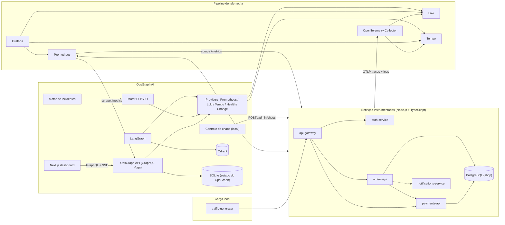
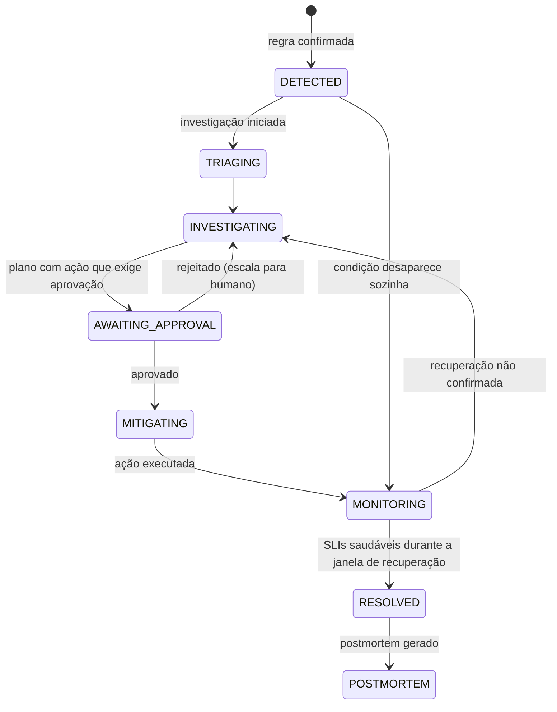

# OpsGraph AI — Plano de Refatoração: Real Observability Mode

> **Objetivo:** transformar o OpsGraph AI numa plataforma de SRE e observabilidade em que disponibilidade, latência, taxa de erro, burn rate, traces, logs e incidentes vêm de **serviços realmente em execução**, sem telemetria inventada.
> **Princípio central:** uma implementação menor e real vale mais que uma arquitetura maior e falsa. Se uma integração não funcionar, a UI mostra `DISCONNECTED` / `NO DATA` em vez de preencher valores.
> **Data:** 17/10/2026 · **Substitui:** a parte de telemetria simulada de `implementation_plan.md` (as seções de produto, LangGraph, RAG e design continuam como referência, quando não conflitarem com este documento).

---

## Sumário

1. [Auditoria do código atual](#1-auditoria-do-código-atual)
2. [Arquitetura alvo](#2-arquitetura-alvo)
3. [Topologia local e portas](#3-topologia-local-e-portas)
4. [Serviços reais e `service-kit`](#4-serviços-reais-e-service-kit)
5. [Telemetria: OpenTelemetry, Prometheus, Loki, Tempo](#5-telemetria-opentelemetry-prometheus-loki-tempo)
6. [Gerador de tráfego](#6-gerador-de-tráfego)
7. [Providers de observabilidade do OpsGraph](#7-providers-de-observabilidade-do-opsgraph)
8. [Motor de SLI/SLO, error budget e burn rate](#8-motor-de-slislo-error-budget-e-burn-rate)
9. [Estados de dados: LIVE, STALE, NO DATA, DISCONNECTED](#9-estados-de-dados-live-stale-no-data-disconnected)
10. [Chaos Engineering](#10-chaos-engineering)
11. [Detecção e ciclo de vida de incidentes](#11-detecção-e-ciclo-de-vida-de-incidentes)
12. [Investigação com IA sobre dados reais](#12-investigação-com-ia-sobre-dados-reais)
13. [RAG e base de conhecimento](#13-rag-e-base-de-conhecimento)
14. [API GraphQL e subscriptions](#14-api-graphql-e-subscriptions)
15. [Mudanças no frontend](#15-mudanças-no-frontend)
16. [Grafana](#16-grafana)
17. [Docker Compose](#17-docker-compose)
18. [Testes](#18-testes)
19. [Fases de implementação](#19-fases-de-implementação)
20. [Roteiro de demo e LinkedIn](#20-roteiro-de-demo-e-linkedin)
21. [Coerência dos números da especificação](#21-coerência-dos-números-da-especificação)
22. [Riscos e decisões em aberto](#22-riscos-e-decisões-em-aberto)
23. [Definição de pronto](#23-definição-de-pronto)

---

## 1. Auditoria do código atual

A especificação recebida descreve um painel que **começa degradado** e exibe rótulos como "CENÁRIO SIMULADO" e "Telemetria determinística". O código-fonte atual **já não está nesse estado**. O que existe hoje:

### 1.1 O que já é real (manter)

| Arquivo | O que faz | Decisão |
| :--- | :--- | :--- |
| [collector.ts](file:///c:/Users/kogli/Desktop/Projetos/OpsGraph%20AI/apps/api/src/monitoring/collector.ts) | Sondagens HTTP reais (`fetch` com timeout, sem seguir redirect) gravadas no SQLite | Manter como **verificações sintéticas (blackbox)**, complementares às métricas do Prometheus (whitebox). Passa a alimentar o `HealthProvider` |
| [overview.ts](file:///c:/Users/kogli/Desktop/Projetos/OpsGraph%20AI/apps/api/src/monitoring/overview.ts) | Disponibilidade, p95 e falhas calculados a partir das sondagens; estados `PENDING` e `STALE` | Manter; a lógica de "sem amostras não conta como sucesso" vira regra geral (seção 9) |
| [targets.ts](file:///c:/Users/kogli/Desktop/Projetos/OpsGraph%20AI/apps/api/src/monitoring/targets.ts) | Alvos validados com Zod, URLs sem credenciais | Manter; `monitors.example.json` passa a listar os 5 serviços reais |
| [calculations.ts](file:///c:/Users/kogli/Desktop/Projetos/OpsGraph%20AI/packages/shared/src/sre/calculations.ts) | Funções puras de disponibilidade, budget, burn e esgotamento | Manter e estender; passam a receber contadores vindos do Prometheus |
| [dashboard/page.tsx](file:///c:/Users/kogli/Desktop/Projetos/OpsGraph%20AI/apps/web/src/app/dashboard/page.tsx) + [globals.css](file:///c:/Users/kogli/Desktop/Projetos/OpsGraph%20AI/apps/web/src/app/globals.css) | Layout atual: sidebar, tema escuro, cards de métricas, tabela, faixa de histórico | **Preservar o visual**; trocar as fontes de dados (seção 15) |
| [schema.test.ts](file:///c:/Users/kogli/Desktop/Projetos/OpsGraph%20AI/apps/api/src/graphql/schema.test.ts) | Testes de coleta real contra servidor HTTP local | Manter |

### 1.2 Resquícios de simulação e valores fixos (remover ou substituir)

| Local | Problema | Ação |
| :--- | :--- | :--- |
| [payments-latency.ts](file:///c:/Users/kogli/Desktop/Projetos/OpsGraph%20AI/packages/shared/src/scenario/payments-latency.ts) | Fixture completa do cenário (4,2 s, 14,2%, logs e trace fixos). Não é exportada em `index.ts`, mas continua no código | Excluir |
| [observability.provider.ts](file:///c:/Users/kogli/Desktop/Projetos/OpsGraph%20AI/apps/api/src/providers/observability/observability.provider.ts) | Interface recebe `TelemetryPhase` (BASELINE/INCIDENT/…), conceito exclusivo do mock | Substituir pelas interfaces da seção 7 |
| [telemetry.ts](file:///c:/Users/kogli/Desktop/Projetos/OpsGraph%20AI/packages/shared/src/types/telemetry.ts) | `phase`, `cpuUsage`, `memoryUsage` obrigatórios; formato pensado para fixture | Substituir por tipos de leitura com `source`, `window`, `fetchedAt` e valores anuláveis |
| [schema.prisma](file:///c:/Users/kogli/Desktop/Projetos/OpsGraph%20AI/apps/api/prisma/schema.prisma) | `TelemetrySnapshot.phase` e colunas `availabilityWindow`/`burnRateWindow`/`budgetWindow` em texto | Nova migração: `ReliabilitySnapshot` (valores medidos + janela + origem), sem `phase` |
| `apps/api/prisma/dev.db` | Ainda contém o seed antigo: **5 serviços, 1 incidente falso (`INC-2026-015`), 1 snapshot, 1 deployment** (verificado por contagem somente leitura). Hoje não aparece na API, mas apareceria quando as queries de incidente voltarem | Apagar esses registros ou recriar o banco. **Requer sua confirmação** (perda de dados locais) |
| `apps/api/dist/`, `packages/shared/dist/` | Builds antigos com `MockObservabilityProvider`, seed e cenário. Ignorados pelo Git, mas confundem quem executar o build antigo | Limpar e adicionar script `clean` |
| [availability-status.ts](file:///c:/Users/kogli/Desktop/Projetos/OpsGraph%20AI/apps/web/src/lib/availability-status.ts) e `page.tsx` | Limites 99,9 / 99,8 / 500 ms fixos no frontend | Ler a configuração de SLO pela API |
| [live-refresh.tsx](file:///c:/Users/kogli/Desktop/Projetos/OpsGraph%20AI/apps/web/src/app/dashboard/live-refresh.tsx) | Atualização por polling de página inteira | Trocar por subscription SSE (seção 14) |
| [README.md](file:///c:/Users/kogli/Desktop/Projetos/OpsGraph%20AI/README.md) e [plan-validation.md](file:///c:/Users/kogli/Desktop/Projetos/OpsGraph%20AI/docs/plan-validation.md) | Descrevem o cenário e uma query `incident(id: "INC-2026-015")` que o próprio teste confirma não existir mais | Reescrever (seção 19, fase 10) |

### 1.3 Itens da especificação que não existem no código atual

- Os rótulos "CENÁRIO SIMULADO", "Ambiente de demonstração", "Telemetria determinística" e "Sem credenciais externas" **não aparecem em `apps/web/src`**. Se estão na sua tela, provavelmente vêm de um servidor antigo ainda rodando ou de outra cópia do projeto.
- Também não existem hoje: card de incidente em foco, área de trace, GraphQL Explorer na UI, tabela de serviços (há tabela de *endpoints*), LangGraph, RAG, Qdrant, OpenTelemetry, Docker Compose.
- Consequência: "preservar o design atual" significa preservar sidebar, tema, tipografia, cards e tabelas existentes, e **criar** os painéis de trace, logs, incidente e chaos no mesmo estilo.

---

## 2. Arquitetura alvo



### 2.1 Decisões de arquitetura

| Tema | Decisão | Motivo |
| :--- | :--- | :--- |
| **Métricas** | Cada serviço expõe `/metrics` com `prom-client`; o Prometheus faz scrape direto | Atende a especificação (`/metrics`), controle total dos rótulos, menos peças que exportar métricas via Collector |
| **Traces** | OTel SDK → OTLP → Collector → Tempo | Caminho padrão; o Collector centraliza batching e destino |
| **Logs** | Pino em JSON no stdout **e** via OTLP → Collector → Loki (endpoint OTLP nativo do Loki 3.x) | Mesmo pipeline dos traces, com `traceId`/`spanId` correlacionados. Alternativa se o OTLP do Loki falhar no spike da fase 1: transport `pino-loki` direto |
| **Banco dos serviços** | PostgreSQL real para `payments-api` e `orders-api` (driver `pg` + instrumentação OTel) | Gera spans reais de banco; permite latência real no banco via `pg_sleep` (seção 10) |
| **Banco do OpsGraph** | Continua em SQLite nesta refatoração | A migração de provider exige migrações próprias (já documentado em `plan-validation.md`); não é necessária para a telemetria ser real |
| **Mocks** | Somente em testes automatizados | Requisito 19 e 53 |
| **Chaos invisível à IA** | As ferramentas da IA não consultam o estado de chaos | Se a IA lesse "chaos ativo", a causa-raiz seria trivial e a investigação perderia o valor. A IA vê apenas o que um SRE veria: métricas, logs, traces e eventos de mudança de configuração |

---

## 3. Topologia local e portas

| Componente | Porta | Execução padrão |
| :--- | :--- | :--- |
| `web` (Next.js) | 3000 | Host (`npm run dev`) |
| `api` (OpsGraph GraphQL) | 4000 | Host (`npm run dev`) |
| `api-gateway` | 8080 | Docker |
| `auth-service` | 8081 | Docker |
| `payments-api` | 8082 | Docker |
| `orders-api` | 8083 | Docker |
| `notifications-service` | 8084 | Docker |
| `traffic-generator` | — | Docker (perfil `traffic`) |
| `postgres` | 5432 | Docker |
| `qdrant` | 6333 | Docker |
| `otel-collector` | 4317 (gRPC), 4318 (HTTP) | Docker |
| `prometheus` | 9090 | Docker |
| `loki` | 3100 | Docker |
| `tempo` | 3200 | Docker |
| `grafana` | **3001** (evita conflito com o Next.js) | Docker |

**Comandos alvo:**

```sh
docker compose up -d      # stack de observabilidade + 5 serviços + postgres + qdrant + tráfego
npm run dev               # OpsGraph API + web no host, com hot reload
```

Perfil alternativo `docker compose --profile full up -d` coloca também `api` e `web` em contêiner.

> [!WARNING]
> O Prometheus em contêiner precisa coletar `/metrics` da OpsGraph API no host via `host.docker.internal:4000`. Hoje a API escuta em `127.0.0.1`; no Docker Desktop para Windows isso precisa ser validado na fase 1 (pode exigir `HOST=0.0.0.0` apenas nesse modo, mantendo o padrão seguro em loopback).

---

## 4. Serviços reais e `service-kit`

### 4.1 Pacote compartilhado `packages/service-kit`

Evita duplicar instrumentação nos 5 serviços:

```
packages/service-kit/src/
├── telemetry.ts        # NodeSDK + auto-instrumentations (http, express, undici/fetch, pg), resource attrs
├── logger.ts           # Pino com mixin de traceId/spanId do contexto ativo
├── metrics.ts          # Registry prom-client + middleware HTTP + service_build_info
├── health.ts           # /health, /health/live, /health/ready com checagem de dependências
├── chaos.ts            # Estado de chaos em memória + rotas /admin/chaos (desligado por padrão)
├── http-client.ts      # fetch com timeout explícito, propagação de contexto e log de falha
└── create-service.ts   # Monta Express 5 com tudo acima, na ordem correta
```

`telemetry.ts` precisa ser carregado **antes** de qualquer import instrumentado (`node --import ./telemetry.js`), senão os spans de http/pg não são criados.

### 4.2 Serviços

```
apps/services/
├── api-gateway/            # Entrada pública
├── auth-service/
├── payments-api/
├── orders-api/
├── notifications-service/
└── traffic-generator/
```

| Serviço | Endpoints de negócio | Dependências |
| :--- | :--- | :--- |
| `api-gateway` | `POST /api/payments`, `POST /api/orders`, `GET /api/orders/:id` | auth, payments, orders |
| `auth-service` | `POST /verify` (valida token em memória) | — |
| `payments-api` | `POST /payments`, `GET /payments/:id`, `POST /internal/charge` | PostgreSQL |
| `orders-api` | `POST /orders`, `GET /orders/:id` | PostgreSQL, `payments-api /internal/charge` (timeout 1500 ms), `notifications-service` (assíncrono) |
| `notifications-service` | `POST /notify` (grava em memória e loga) | — |

Fluxos que geram **um único trace distribuído**:

```
POST /api/payments:  api-gateway → auth-service → payments-api → PostgreSQL
POST /api/orders:    api-gateway → auth-service → orders-api → PostgreSQL
                                                 → payments-api → PostgreSQL
                                                 ⇢ notifications-service
```

Todos expõem `/health`, `/health/live`, `/health/ready` e `/metrics`. Exemplo de `/health`:

```json
{ "status": "healthy", "service": "payments-api", "version": "1.0.0", "commit": "a18d3f2",
  "timestamp": "2026-10-17T22:10:00.000Z", "checks": { "postgres": "ok" } }
```

`/health/ready` retorna 503 se o PostgreSQL não responder; `/health/live` só indica que o processo responde.

---

## 5. Telemetria: OpenTelemetry, Prometheus, Loki, Tempo

### 5.1 Métricas HTTP (todos os serviços)

| Métrica | Tipo | Rótulos |
| :--- | :--- | :--- |
| `http_requests_total` | Counter | `service`, `method`, `route`, `status_code`, `environment` |
| `http_request_duration_seconds` | Histogram | `service`, `method`, `route`, `environment` |
| `http_request_errors_total` | Counter | `service`, `method`, `route`, `error_type` (`http_5xx`, `timeout`, `connection`) |
| `service_health` | Gauge (1/0) | `service`, `check` |
| `service_build_info` | Gauge (=1) | `service`, `version`, `commit` |

Regras de rótulos (requisito 5):
- `route` é o **template** da rota (`/orders/:id`), nunca a URL concreta. Rotas desconhecidas viram `route="unmatched"`.
- Nunca usar IDs, tokens, trace IDs ou mensagens de erro como rótulo.
- `/health*` e `/metrics` **não** entram em `http_requests_total` (não fazem parte do SLI de usuário).

Buckets do histograma, com resolução onde o SLO decide (500 ms):

```
0.005, 0.01, 0.025, 0.05, 0.1, 0.15, 0.2, 0.25, 0.3, 0.4, 0.5, 0.75, 1, 1.5, 2.5, 5, 10
```

> [!NOTE]
> `histogram_quantile` interpola dentro do bucket; o p95 exibido é uma estimativa limitada por esses limites. O SLI de latência ("95% abaixo de 500 ms") é calculado de forma **exata** pelo bucket `le="0.5"`, sem interpolação.

### 5.2 Métricas da plataforma OpsGraph (API)

| Métrica | Tipo | Rótulos |
| :--- | :--- | :--- |
| `opsgraph_incidents_total` | Counter | `service`, `type`, `severity` |
| `opsgraph_incidents_active` | Gauge | `service` |
| `opsgraph_incidents_resolved_total` | Counter | `service`, `type` |
| `opsgraph_workflow_duration_seconds` | Histogram | `outcome` |
| `opsgraph_agent_execution_duration_seconds` | Histogram | `agent`, `outcome` |
| `opsgraph_llm_calls_total` | Counter | `provider`, `model`, `outcome` |
| `opsgraph_llm_tokens_total` | Counter | `provider`, `model`, `type` — **só incrementa se o provider retornar uso** |
| `opsgraph_rag_queries_total` | Counter | `outcome` |
| `opsgraph_tool_calls_total` | Counter | `tool`, `outcome` |
| `opsgraph_human_approvals_total` | Counter | `decision` |
| `opsgraph_remediation_executions_total` | Counter | `action`, `outcome` |
| `opsgraph_provider_up` | Gauge | `provider` (prometheus, loki, tempo, grafana, collector) |

### 5.3 Traces

- Auto-instrumentação de `http`, `express`, `undici` (fetch) e `pg`.
- Na OpsGraph API: spans para resolvers GraphQL (plugin OTel do Yoga ou `@envelop/opentelemetry`), nós do LangGraph, ferramentas, chamadas LLM e busca no Qdrant.
- Propagação W3C `traceparent` em todas as chamadas entre serviços (automática com fetch instrumentado).
- Erros: `span.recordException` + status `ERROR`; timeouts geram span de cliente com erro.

### 5.4 Logs (Pino)

Campos padrão: `timestamp`, `level`, `service`, `environment`, `traceId`, `spanId`, `requestId`, `message`, `durationMs`, `route`, `statusCode`, `err`.

Exemplos de logs que surgem **naturalmente** dos sintomas, sem texto mencionando chaos:

```json
{"level":"warn","service":"payments-api","traceId":"…","message":"slow database query","durationMs":1612,"query":"insert_payment"}
{"level":"error","service":"payments-api","traceId":"…","message":"request failed","statusCode":500,"route":"/payments"}
{"level":"error","service":"orders-api","traceId":"…","message":"dependency timeout","dependency":"payments-api","timeoutMs":1500}
```

Rótulos do Loki (baixa cardinalidade): `service_name`, `environment`, `level`. `traceId` fica como metadado estruturado, não como rótulo.

---

## 6. Gerador de tráfego

- Processo próprio (`apps/services/traffic-generator`), ativado por `TRAFFIC_GENERATOR_ENABLED=true`.
- Carga leve: `TRAFFIC_RPS=4` por padrão (máx. 20), mistura configurável (60% pagamentos, 30% pedidos, 10% consultas), jitter aleatório, ~5% de requisições inválidas que retornam **4xx** (não contam como falha de disponibilidade, mas tornam o tráfego realista).
- Respeita backpressure: no máximo N requisições simultâneas; não acumula fila quando o sistema fica lento.
- Exibe na UI o indicador `LOCAL ENVIRONMENT · tráfego gerado localmente`. As medições são reais; a origem do tráfego é sintética e isso fica explícito.

---

## 7. Providers de observabilidade do OpsGraph

### 7.1 Contrato comum de resultado

```typescript
export type DataState = 'LIVE' | 'STALE' | 'NO_DATA' | 'DISCONNECTED' | 'DEGRADED';

export interface ProviderResult<T> {
  state: DataState;
  data: T | null;           // null em NO_DATA / DISCONNECTED
  source: 'prometheus' | 'loki' | 'tempo' | 'health' | 'synthetic';
  fetchedAt: string;        // quando o OpsGraph consultou
  observedAt: string | null;// timestamp da amostra mais recente
  window?: string;          // ex.: "1m", "5m"
  error?: string;           // mensagem segura, sem segredos
}
```

### 7.2 Interfaces e implementações

| Interface | Implementação real | Operações |
| :--- | :--- | :--- |
| `MetricsProvider` | `PrometheusMetricsProvider` (`/api/v1/query`, `/api/v1/query_range`) | `getServiceReliability(service, window)`, `getSeries(service, metric, range, step)` |
| `LogsProvider` | `LokiLogsProvider` (`/loki/api/v1/query_range`) | `searchLogs(service, timeRange, level?, contains?)`, `countByLevel(service, timeRange)` |
| `TracingProvider` | `TempoTracingProvider` (`/api/search` com TraceQL, `/api/traces/{id}`) | `searchTraces(service, timeRange, minDuration?, status?)`, `getTrace(traceId)`, análise: span mais longo, spans com erro, spans anômalos |
| `HealthProvider` | `HttpHealthProvider` (usa `/health/ready` dos serviços + sondagens sintéticas existentes) | `getServiceHealth(service)`, `getAllHealth()` |
| `ChangeProvider` (antigo `DeploymentProvider`) | Prometheus (`changes(service_build_info…)`, `process_start_time_seconds`) + eventos de configuração registrados pelo OpsGraph | `getRecentChanges(service, timeRange)` |
| `ObservabilityHealthProvider` | Pings reais: Prometheus `/-/ready`, Loki `/ready`, Tempo `/ready`, Grafana `/api/health`, Collector `:13133` (health_check extension) | `getStatus()` → por provider: `CONNECTED` / `DEGRADED` / `DISCONNECTED` + latência + último sucesso |

Todas as chamadas têm timeout (padrão 3 s), não lançam exceção para o resolver (retornam `DISCONNECTED` com `error`) e geram span + métrica `opsgraph_provider_up`.

### 7.3 Catálogo de consultas

PromQL (janela `$w` configurável; `$s` = serviço):

```promql
# Disponibilidade (fração de não-5xx)
sum(rate(http_requests_total{service="$s",status_code!~"5.."}[$w]))
/ sum(rate(http_requests_total{service="$s"}[$w]))

# Taxa de erro (5xx)
sum(rate(http_requests_total{service="$s",status_code=~"5.."}[$w]))
/ sum(rate(http_requests_total{service="$s"}[$w]))

# p50 / p95 / p99
histogram_quantile(0.95, sum by (le) (rate(http_request_duration_seconds_bucket{service="$s"}[$w])))

# SLI de latência exato: fração abaixo de 500 ms
sum(rate(http_request_duration_seconds_bucket{service="$s",le="0.5"}[$w]))
/ sum(rate(http_request_duration_seconds_count{service="$s"}[$w]))

# Volume (para distinguir "sem tráfego" de "100% saudável")
sum(rate(http_requests_total{service="$s"}[$w]))
sum(increase(http_requests_total{service="$s"}[$w]))
```

LogQL:

```logql
{service_name="payments-api"} | json | level=~"error|warn"
sum by (level) (count_over_time({service_name="payments-api"} | json [5m]))
```

TraceQL:

```traceql
{ resource.service.name = "payments-api" && duration > 500ms }
{ resource.service.name = "orders-api" && status = error }
```

---

## 8. Motor de SLI/SLO, error budget e burn rate

### 8.1 Configuração de SLO (no repositório, servida pela API)

```yaml
# config/slo.yaml
defaults:
  availability: { target: 99.9 }      # %
  latency: { threshold_ms: 500, target: 95 }  # 95% das requisições < 500 ms
  error_rate: { max: 1.0 }            # %
  budget_window: 30d
services:
  auth-service: { availability: { target: 99.95 } }
```

O frontend deixa de ter limites fixos e lê `sloStatus(service)`.

### 8.2 Janelas

| Uso | Janela | Motivo |
| :--- | :--- | :--- |
| Cards "atuais" no dashboard | `1m` (configurável `RELIABILITY_WINDOW`) | Reage rápido; mostrado na UI como "janela 1 min" |
| Avaliação de SLO e burn rate | `5m` | Menos ruído |
| Detecção de incidente | `1m` com confirmação de 3 avaliações | Ver seção 11 |
| Error budget | `min(30d, dados disponíveis)` | Ver 8.4 |

> [!IMPORTANT]
> Janelas de `rate()` têm "memória": depois que uma falha termina, uma janela de 5 min ainda mostra a falha por até 5 min. Por isso a UI sempre mostra a janela usada, e a verificação de recuperação usa janelas curtas (seção 12.5).

### 8.3 Estados

| Indicador | `HEALTHY` | `AT_RISK` | `BREACHED` |
| :--- | :--- | :--- | :--- |
| Disponibilidade | ≥ alvo | — (coberto pelo burn) | < alvo |
| Latência (SLI exato) | ≥ 95% < 500 ms e p95 < 400 ms | p95 entre 400 e 500 ms | < 95% abaixo de 500 ms |
| Taxa de erro | < 0,5% | 0,5%–1% | > 1% |
| Burn rate | < 1x | 1x–2x | > 2x |

Estado do serviço = pior estado entre os indicadores. Rótulos do burn rate segundo a especificação: `< 1x HEALTHY`, `1–2x WARNING`, `2–6x HIGH`, `> 6x CRITICAL`.

### 8.4 Error budget com dados honestos

- `allowedErrorRatio = 1 - target/100` (0,001 para 99,9%).
- `coverageSeconds = min(30d, agora − primeira amostra do serviço no Prometheus)`, obtido por consulta (ex.: `min_over_time(timestamp(up{job="$s"})[30d:5m])`).
- `budgetAllowed = totalRequests(coverage) × allowedErrorRatio`; `budgetConsumed = failedRequests(coverage)`; `remaining% = max(0, 1 − consumed/allowed) × 100`.
- A UI mostra **"Janela: 2h14m de dados (meta 30 d)"** enquanto não houver 30 dias. Nunca finge histórico.
- Retenção do Prometheus configurada para 30 dias (`--storage.tsdb.retention.time=30d`).

### 8.5 Burn rate

`burnRate = observedErrorRatio(5m) / allowedErrorRatio`. Ex.: 0,0004 → 0,4x; 0,008 → 8x. Sem tráfego na janela → `NO_DATA`, nunca 0x.

### 8.6 Tratamento de divisão por zero

- PromQL retorna vetor vazio ou `NaN` quando não há tráfego. O provider converte isso em `NO_DATA`.
- Se houver amostra válida mais antiga dentro do limite de frescor, mostra o último valor com estado `STALE` e o horário.
- Disponibilidade **nunca** vira 0% nem 100% por ausência de tráfego.

---

## 9. Estados de dados: LIVE, STALE, NO DATA, DISCONNECTED

| Estado | Condição | Visual |
| :--- | :--- | :--- |
| `LIVE` | Consulta bem-sucedida e amostra mais recente com menos de `STALE_AFTER_SECONDS` (padrão 30 s) | Ponto verde pulsando, "Atualizado há 3 s" |
| `STALE` | Consulta ok, mas amostra mais antiga que o limite | Âmbar, "Dados de 2 min atrás" |
| `NO_DATA` | Provider ok, mas sem tráfego/amostras na janela | Cinza, "—" + "NO DATA" |
| `DISCONNECTED` | Provider não responde | Vermelho, valores ocultos |
| `DEGRADED` | Parte dos providers falha (ex.: Prometheus ok, Tempo fora) | Âmbar no indicador global |

Toda leitura exposta pela API carrega `state`, `fetchedAt` e `observedAt`. O indicador global `LIVE TELEMETRY` só fica verde se o Prometheus estiver `LIVE`.

---

## 10. Chaos Engineering

### 10.1 Mecanismo

- Cada serviço mantém o estado de chaos **em memória** (`service-kit/chaos.ts`). Reiniciar o serviço zera tudo.
- A OpsGraph API controla os serviços por `POST /admin/chaos` e `DELETE /admin/chaos`, com token compartilhado (`CHAOS_ADMIN_TOKEN`).
- Rotas `/admin/*` só existem se `CHAOS_ENABLED=true` **e** `NODE_ENV !== 'production'`. Caso contrário, retornam 404.
- Cada injeção tem **TTL obrigatório** (padrão 10 min, máx. 30 min) e expira sozinha.
- Toda mudança gera log `runtime configuration changed` e um evento de mudança de configuração (`ChangeProvider`), como aconteceria com uma alteração de configuração real. O evento descreve o parâmetro (`db.query_delay_ms: 0 → 1500`), sem a palavra "chaos".

### 10.2 Cenários

| Cenário | Parâmetros | Implementação real | Efeitos esperados |
| :--- | :--- | :--- | :--- |
| **Latência de banco** | 500 / 1000 / 1500 / 3000 ms | `payments-api` executa `SELECT pg_sleep($1)` dentro da transação do pagamento: o atraso acontece **no PostgreSQL** | p95 sobe no Prometheus; span `pg` lento no Tempo; logs `slow database query` no Loki; burn sobe se requisições passarem de 500 ms |
| **Pico de erros** | `CHAOS_ERROR_RATE` 5–50% (padrão 20%) | Middleware retorna HTTP 500 numa fração das requisições de negócio, com log de erro e exceção no span | Taxa de erro e burn sobem; disponibilidade cai |
| **Timeout de dependência** | atraso 2000–5000 ms em `payments-api /internal/charge` | O atraso excede o timeout de 1500 ms do cliente em `orders-api`, que aborta e responde 504 | Spans de cliente com erro, logs `dependency timeout`, latência e erros em `orders-api` |

### 10.3 Segurança

- Desligado por padrão em todos os ambientes.
- Rota `/chaos` no frontend com faixa fixa **LOCAL / DEMO ENVIRONMENT ONLY**.
- Estado ativo visível em todas as páginas (pílula na barra superior, com contagem regressiva do TTL).
- Botão **RESET ALL CHAOS**, que chama todos os serviços e confirma o estado depois.
- Nenhuma ação altera disco, banco de forma permanente, host ou processos.
- Mutations `enableChaos` / `resetAllChaos` só aparecem no schema GraphQL quando `CHAOS_ENABLED=true`.

---

## 11. Detecção e ciclo de vida de incidentes

### 11.1 Avaliador

- Loop na OpsGraph API a cada `INCIDENT_EVAL_INTERVAL_SECONDS=15`.
- Para cada serviço, avalia regras sobre as leituras do motor SRE (janela 1 min):

| Tipo | Condição |
| :--- | :--- |
| `AVAILABILITY` | disponibilidade < alvo |
| `ERROR_RATE` | taxa de erro > 1% |
| `LATENCY` | p95 > 500 ms ou SLI de latência < 95% |
| `BURN_RATE` | burn (5m) > 2x |

- Regras só são avaliadas com tráfego mínimo (`MIN_REQUESTS_PER_WINDOW=20`), para evitar incidentes com 1 requisição.
- **Confirmação:** a condição precisa ser verdadeira em 3 avaliações consecutivas (~45 s).
- **Deduplicação:** chave `serviço + tipo`. Se já houver incidente ativo com a mesma chave, apenas acrescenta evidência à timeline. Várias regras disparando juntas no mesmo serviço são agrupadas num único incidente (tipo principal = o de maior severidade).
- **Severidade:** SEV-1 se disponibilidade < 99% ou burn > 14x; SEV-2 se burn > 6x ou p95 > 2 s; SEV-3 nos demais casos.
- Nenhum incidente é criado na inicialização, a menos que as regras sejam realmente violadas.
- Estado persistido no SQLite; após reinício da API, incidentes ativos são recarregados e o contador de confirmação recomeça.

### 11.2 Ciclo de vida



Cada transição grava evento na timeline com as medições que a justificaram.

---

## 12. Investigação com IA sobre dados reais

### 12.1 Fluxo LangGraph (preservado)

```
START → triage → collect_observability → evaluate_sre → retrieve_knowledge → investigate
      → generate_remediation_plan → evaluate_risk → human_approval
      → execute_safe_local_remediation → verify_recovery → generate_postmortem → END
```

- Checkpointer persistente (`@langchain/langgraph-checkpoint-sqlite`) com `thread_id = incidentId`, para a pausa de aprovação sobreviver a reinícios.
- `collect_observability` executa as ferramentas **em paralelo**.

### 12.2 Ferramentas (todas sobre os providers reais)

| Ferramenta | Provider | Retorno resumido para o LLM |
| :--- | :--- | :--- |
| `getServiceMetrics` | Prometheus | SLIs atuais e séries recentes (amostradas) |
| `searchLogs` | Loki | Contagem por nível + até 30 linhas de erro/warn mais relevantes |
| `searchTraces` | Tempo | Até 10 traces lentos/com erro, com span mais longo e % do tempo total por serviço |
| `getHealthStatus` | Health | Prontidão e checagens de dependência |
| `getSLOStatus` | Motor SRE | Estados, burn, budget e cobertura |
| `getRecentChanges` | Change | Versões, reinícios e mudanças de configuração na janela |
| `searchKnowledge` | Qdrant | Documentos relevantes com score |

As saídas são reduzidas antes de ir ao LLM (limites de linhas e spans) para controlar tokens. Cada chamada gera span e métrica.

### 12.3 Regras de honestidade da IA

- Nenhuma causa-raiz fixa no código. Hipóteses vêm do LLM, com saída validada por Zod e evidências que citam medições reais (valor, janela, trace ID).
- Sem `LLM_PROVIDER` configurado: a coleta de evidências e o motor SRE funcionam normalmente; as etapas de IA aparecem como **"LLM não configurado"**. Não há fallback que finja respostas de IA.
- Tokens e custo só aparecem se o provider retornar `usage`; custo exige tabela de preços configurada. Caso contrário, "não informado".
- O raciocínio privado do modelo não é exibido nem salvo; a UI mostra o resumo estruturado (evidências, hipóteses, ferramentas, documentos, decisão).

### 12.4 Remediação local segura

Catálogo fechado (allowlist), executado por chamadas HTTP aos serviços — nunca shell:

| Ação | Efeito |
| :--- | :--- |
| `restore_runtime_config(service)` | Volta a configuração de runtime ao padrão (remove injeções ativas daquele serviço) |
| `restore_dependency_timeout(service)` | Restaura timeout/atraso padrão de dependência |
| `reset_error_injection(service)` | Zera a taxa de erro injetada |

O planner só pode escolher ações desse catálogo. Toda ação que afeta um serviço exige aprovação humana, registrada com operador, horário, ação, incidente e execução (auditoria). Proibido: reiniciar máquina, apagar bancos, alterar host, executar comandos.

O card de aprovação mostra: ação sugerida, evidências, risco, confiança, serviço afetado, impacto esperado, `APPROVE` / `REJECT`.

### 12.5 Verificação de recuperação

- Após a ação, o incidente vai para `MONITORING`.
- Critério: disponibilidade, p95, erro e burn dentro do SLO em janelas de 1 min, por `RECOVERY_WINDOW_SECONDS=120` consecutivos, com tráfego mínimo, e `/health/ready` ok.
- Só então `RESOLVED`. Se o prazo máximo (10 min) passar sem recuperação, volta para `INVESTIGATING`.

### 12.6 Postmortem

Gerado a partir do registro do incidente: início da degradação (primeira avaliação violada), detecção, serviço, medições reais em cada transição, trace IDs e trechos de log, causa-raiz, mitigação e aprovador, tempo de recuperação, **MTTD** (detecção − início da degradação), **MTTR** (resolução − início da degradação), impacto no SLO e no budget (com a cobertura real). Salvo no banco, exportado como Markdown em `knowledge/postmortems/` e indexado no Qdrant.

---

## 13. RAG e base de conhecimento

- Documentos Markdown do projeto, indexados no Qdrant: `knowledge/architecture`, `runbooks`, `postmortems`, `troubleshooting`. São conhecimento do projeto, não telemetria.
- Arquitetura descreve os **5 serviços reais** e suas dependências.
- Runbook obrigatório `knowledge/runbooks/database-latency.md` com: sintomas, passos de diagnóstico, as consultas PromQL/LogQL/TraceQL deste projeto (seção 7.3), indicadores no trace (span `pg` dominante), opções de mitigação, rollback de configuração e verificação.
- Runbooks adicionais: `error-spike.md`, `dependency-timeout.md`, `slo-burn-rate.md`.
- Embeddings: provider configurado (OpenAI ou Gemini). Sem chave, busca lexical local (BM25) com o rótulo **"busca lexical"** visível — não chamada de semântica.
- Qdrant indisponível → `retrieve_knowledge` registra falha na timeline e a investigação segue sem documentos, informando isso.

---

## 14. API GraphQL e subscriptions

### 14.1 Organização

```
apps/api/src/graphql/
├── schema/           # typeDefs por domínio: reliability, incidents, observability, chaos, knowledge
├── resolvers/
├── pubsub.ts         # createPubSub do graphql-yoga
└── index.ts
```

### 14.2 Queries

```graphql
enum DataState { LIVE STALE NO_DATA DISCONNECTED DEGRADED }
enum SloState { HEALTHY AT_RISK BREACHED }

type ServiceReliability {
  service: String!
  state: DataState!
  window: String!
  lastUpdatedAt: String!
  observedAt: String
  requestsPerSecond: Float
  availability: Float
  latencyP50: Float
  latencyP95: Float
  latencyP99: Float
  latencySli: Float
  errorRate: Float
  burnRate: Float
  burnLevel: String
  sloStatus: SloState
}

type Query {
  services: [ServiceSummary!]!
  serviceReliability(service: String!): ServiceReliability!
  serviceMetrics(service: String!, range: String!): MetricSeriesResult!
  serviceLogs(service: String!, range: String!, level: String): LogsResult!
  serviceTraces(service: String!, range: String!, minDurationMs: Int, onlyErrors: Boolean): TracesResult!
  trace(traceId: ID!): TraceResult!
  sloStatus(service: String!): SloStatus!
  errorBudget(service: String!): ErrorBudget!
  activeIncidents: [Incident!]!
  incidents(limit: Int): [Incident!]!
  incident(id: ID!): Incident
  observabilityHealth: ObservabilityHealth!
  chaosState: ChaosState
  monitoring: MonitoringOverview!   # verificações sintéticas existentes, mantidas
}
```

### 14.3 Mutations

`startInvestigation`, `approveRemediation`, `rejectRemediation`, `enableChaos` e `resetAllChaos` (só com chaos habilitado), `reindexKnowledge`.

### 14.4 Subscriptions (SSE)

`reliabilityUpdated`, `serviceHealthUpdated`, `incidentDetected`, `incidentUpdated`, `agentExecutionUpdated`, `chaosStateUpdated`, `observabilityHealthUpdated`.

O servidor consulta os providers num único loop (`RELIABILITY_POLL_SECONDS=5`) e publica para todos os clientes. Os navegadores não consultam o Prometheus. O polling de página inteira de `live-refresh.tsx` é removido.

---

## 15. Mudanças no frontend

Preservar sidebar, tema, tipografia, cards, espaçamentos e tabelas. Mudanças:

| Área | Mudança |
| :--- | :--- |
| **Cards do topo** | Disponibilidade, p95, taxa de erro, burn rate (com budget restante e cobertura), vindos de `serviceReliability` agregado + subscription. Cada card mostra janela e estado de dados |
| **Indicador global** | `LIVE TELEMETRY` / `STALE` / `DEGRADED` + "Atualizado há N s" + `LOCAL ENVIRONMENT` |
| **Sidebar** | Bloco **OBSERVABILITY** com OpenTelemetry Collector, Prometheus, Loki, Tempo e Grafana, cada um `Connected` / `Degraded` / `Disconnected` vindo de `observabilityHealth` |
| **Resumo** | "5 / 5 serviços saudáveis · 0 incidentes ativos" |
| **Sem incidente** | Estado **NO ACTIVE INCIDENTS** — "Todos os serviços monitorados estão dentro do SLO." — seguido de "Eventos recentes de confiabilidade" (incidentes resolvidos, mudanças de configuração, transições de estado) |
| **Com incidente** | Card **INCIDENT IN FOCUS** (SEV, estado, serviço, título, duração, medições na detecção), só quando o motor de incidentes cria um |
| **Tabela de serviços** | 5 serviços com disponibilidade, p95, erro, burn, estado SLO, prontidão |
| **Verificações sintéticas** | A faixa de histórico e a tabela de sondagens atuais continuam, renomeadas para "Verificações sintéticas" |
| **`/services/[name]`** | Gráficos de p50/p95/p99, erro e RPS (`serviceMetrics`), logs recentes (Loki), traces recentes (Tempo), mudanças |
| **`/incidents/[id]`** | Timeline, grafo do LangGraph, evidências, hipóteses, aprovação, trace real (waterfall com span mais lento destacado), logs filtráveis por nível, links "Abrir no Grafana" |
| **`/chaos`** | Os 3 cenários com parâmetros, TTL, estado ativo, `RESET ALL CHAOS`, faixa `LOCAL / DEMO ENVIRONMENT ONLY` |
| **Remoções** | Qualquer menção a cenário simulado ou telemetria determinística |

Painéis cujo provider estiver `DISCONNECTED` exibem o estado e uma dica de diagnóstico, nunca valores de exemplo.

---

## 16. Grafana

Provisionamento em `infra/grafana/provisioning/`:

- **Datasources:** Prometheus, Loki (com *derived field* `traceId` → Tempo) e Tempo (com *traces to logs* → Loki e *traces to metrics* → Prometheus).
- **Dashboard "Service Reliability":** disponibilidade, RPS, p50/p95/p99, taxa de erro, contagem de 5xx, estado SLO, burn rate, incidentes ativos — variável `$service`.
- **Dashboard "OpsGraph AI Platform":** execuções do LangGraph, execuções e duração por agente, duração do workflow, chamadas LLM, RAG, ferramentas, falhas, aprovações, remediações, tokens e custo (painéis de tokens/custo mostram "No data" se o provider não informar uso).

---

## 17. Docker Compose

```
infra/
├── otel-collector/config.yaml   # receivers: otlp; processors: batch, memory_limiter; exporters: otlp→tempo, otlphttp→loki
├── prometheus/prometheus.yml    # scrape: 5 serviços, opsgraph api (host.docker.internal:4000), collector, tempo, loki
├── loki/config.yaml             # single binary, filesystem, OTLP habilitado
├── tempo/tempo.yaml             # single binary, armazenamento local
├── postgres/init.sql            # banco "shop", tabelas payments e orders
└── grafana/provisioning/{datasources,dashboards}/
docker-compose.yml               # perfis: padrão (stack + serviços), traffic, full (inclui api e web)
```

- Versões de imagem fixadas (definidas no spike da fase 1, com verificação de compatibilidade OTLP Loki/Tempo).
- Healthchecks e `depends_on: condition: service_healthy`.
- Volumes nomeados para Prometheus, Loki, Tempo, Grafana, Postgres e Qdrant.
- Consumo estimado: 14 contêineres, ~3–4 GB de RAM. Documentar no README.

---

## 18. Testes

Mocks e fixtures **apenas** dentro de testes.

| Área | Testes |
| :--- | :--- |
| Cálculos | disponibilidade, latência (SLI pelo bucket), taxa de erro, burn rate, budget com cobertura parcial, divisão por zero → `NO_DATA` |
| Estados | SLO (`HEALTHY`/`AT_RISK`/`BREACHED`), níveis de burn, frescor (`LIVE`/`STALE`) |
| Providers | parsing de respostas reais gravadas do Prometheus/Loki/Tempo (fixtures só de teste); timeout e 5xx → `DISCONNECTED` sem exceção |
| Incidentes | confirmação de 3 avaliações, picos curtos não criam incidente, deduplicação por serviço+tipo, agrupamento, tráfego mínimo, recuperação só após janela |
| Chaos | gate de ambiente (404 em produção/desligado), TTL expira, `RESET ALL` limpa todos os serviços, token obrigatório |
| Remediação | só ações do catálogo; aprovação obrigatória; rejeição não executa nada |
| Integração | `npm run verify:stack`: com o compose no ar, verifica targets `up` no Prometheus, trace distribuído com ≥ 4 serviços no Tempo, logs com `traceId` no Loki, dashboards provisionados no Grafana |

Os testes existentes de coleta HTTP e de cálculos continuam passando.

---

## 19. Fases de implementação

Cada fase termina com o projeto executável. As fases 0–6 entregam a história "real" completa sem IA; 7–8 adicionam a IA.

| Fase | Entrega | Pronto quando |
| :--- | :--- | :--- |
| **0. Limpeza** | Remover cenário, `TelemetryPhase`, builds antigos; migração `ReliabilitySnapshot`; limpar seed do `dev.db` (com sua confirmação); script `clean` | `grep` por cenário/fixture em `src` vazio; testes atuais passam |
| **1. Stack de observabilidade** | Compose com Collector, Prometheus, Loki, Tempo, Grafana (datasources provisionados); spike de versões e de rede host↔Docker | Grafana abre com 3 datasources verdes |
| **2. Serviços + tráfego** | `service-kit`, 5 serviços, Postgres, traffic-generator | No Grafana: métricas dos 5 serviços, trace distribuído gateway→auth→payments→pg, logs com `traceId` |
| **3. Providers + motor SRE** | 6 providers, `config/slo.yaml`, queries GraphQL de confiabilidade, `observabilityHealth`, métricas `opsgraph_*` básicas | `serviceReliability` retorna valores iguais aos do Grafana; desligar o Loki mostra `DISCONNECTED` |
| **4. Dashboard ao vivo** | Cards, indicador LIVE, frescor, sidebar de observabilidade, tabela de 5 serviços, estado sem incidentes, subscriptions SSE | Dashboard inicia verde com valores reais; parar o Prometheus deixa tudo `DISCONNECTED`/`STALE` |
| **5. Chaos** | 3 cenários, segurança, `/chaos`, eventos de mudança | Cada cenário altera métricas, traces e logs reais; `RESET ALL` restaura |
| **6. Incidentes** | Avaliador, confirmação, deduplicação, ciclo de vida, `/incidents/[id]` com trace e logs reais | Latência de banco gera **um** incidente em ~1 min; reset leva a `MONITORING` → `RESOLVED` |
| **7. RAG** | Docs da arquitetura real, runbooks, ingestão no Qdrant, busca | Busca por "slow database query" retorna `database-latency.md` |
| **8. LangGraph** | Agentes com ferramentas reais, checkpoint, aprovação, remediação do catálogo, verificação, postmortem indexado | Fluxo completo da seção 20 funciona com LLM configurado |
| **9. Plataforma observável** | Spans e métricas de agentes/LLM/RAG/ferramentas; dashboard Grafana "OpsGraph AI Platform" | Execução aparece no Tempo e no dashboard |
| **10. Documentação e demo** | README (fluxo real, setup, endpoints, limites), atualizar `plan-validation.md`, roteiro de demo | Pessoa nova sobe tudo com 2 comandos seguindo o README |

---

## 20. Roteiro de demo e LinkedIn

### 20.1 Sequência (tempos reais aproximados)

| Tempo | Evento |
| :--- | :--- |
| 0:00 | Dashboard verde: 5/5 serviços saudáveis, 0 incidentes, `LIVE TELEMETRY`, providers `Connected` |
| 0:15 | Em `/chaos`: **Latência de banco +1500 ms** em `payments-api` |
| 0:20–0:40 | p95 sobe nos cards (janela 1 min); traces mostram span `pg` dominante; logs `slow database query` |
| ~1:00 | Confirmação de 3 avaliações → incidente `DETECTED`, card **INCIDENT IN FOCUS** |
| 1:00–1:40 | LangGraph: ferramentas consultam Prometheus, Loki, Tempo e mudanças; RAG retorna o runbook; hipótese com evidências |
| ~1:45 | `AWAITING_APPROVAL`: `restore_runtime_config(payments-api)` |
| ~2:00 | Aprovação → chaos removido → `MONITORING` |
| 2:00–4:00 | Métricas voltam; janela de recuperação de 2 min |
| ~4:00 | `RESOLVED` → postmortem gerado e indexado |

A demo real leva ~4–5 min. Para um vídeo curto no LinkedIn, acelerar trechos na edição — sem alterar os valores mostrados.

### 20.2 Capturas

- **Saudável:** dashboard com os valores medidos naquele momento.
- **Incidente:** card em foco + grafo do LangGraph em execução + origem `LIVE TELEMETRY`.
- Os valores das capturas serão os medidos, não os exemplos da especificação (ver seção 21).

---

## 21. Coerência dos números da especificação

Os exemplos de valores da especificação não são consistentes entre si quando medidos na mesma janela, e telemetria real sempre será. Exemplos:

| Exemplo da especificação | Problema |
| :--- | :--- |
| Saudável: disponibilidade 99,95% e erro 0,18% | 99,95% implica 0,05% de erro. Com 0,18% de erro, a disponibilidade seria 99,82% e o SLO estaria violado |
| Saudável: erro 0,18% e burn 0,4x | Para SLO 99,9%, erro de 0,18% dá burn de **1,8x** |
| Incidente: erro 3,7% e burn 4,9x | Erro de 3,7% dá burn de **37x** |
| Incidente: disponibilidade 99,86% e erro 3,7% | 99,86% implica 0,14% de erro |

Além disso, o sistema real **sem falhas** tende a medir 100,00% de disponibilidade, 0,00% de erro e burn de 0x, e latências de ~5–30 ms em localhost — não 99,95% / 0,18% / 148 ms.

O plano **não** ajusta números para bater com os exemplos. Ver decisão D1 na seção 22.

---

## 22. Riscos e decisões em aberto

| # | Decisão / risco | Opções | Recomendação |
| :--- | :--- | :--- | :--- |
| **D1** | Valores do estado saudável | (a) Mostrar o que for medido (provável 100% / 0% / ~20 ms). (b) Adicionar **comportamento realista explícito e configurável** nos serviços: tempo de trabalho simulado (ex.: provedor de pagamento 60–150 ms) e taxa de falha de fundo baixa (ex.: 0,03%) — medidos de verdade, documentados no README e visíveis em `/chaos` como "perfil de carga" | (b) com padrão documentado. As medições continuam reais; o que se modela é o comportamento do serviço, não a métrica |
| **D2** | Apagar o seed antigo do `dev.db` | Apagar só as tabelas do cenário / recriar o banco | Recriar (o histórico de sondagens tem só 2 registros) — **aguarda sua confirmação** |
| **D3** | Rótulos "CENÁRIO SIMULADO" na sua tela | Não existem em `src`; provável servidor ou build antigo | Confirmar de onde vem a tela antes da fase 4 |
| **D4** | LLM | OpenAI ou Gemini; sem chave, IA aparece como "não configurada" | Definir provider e modelo antes da fase 8 |
| **D5** | Recursos | 14 contêineres (~3–4 GB RAM) no Windows | Perfil `minimal` sem Grafana/Qdrant para máquinas menores |
| **D6** | Rede host↔Docker | Prometheus coletando a API no host | Validar no spike da fase 1 |
| **D7** | OTLP no Loki | Versões recentes do Loki suportam; validar no spike | Fallback `pino-loki` documentado |
| **D8** | Banco do OpsGraph | SQLite agora / PostgreSQL depois | SQLite nesta refatoração |

---

## 23. Definição de pronto

- [ ] Os 5 serviços rodam e respondem `/health`, `/health/live`, `/health/ready` e `/metrics`.
- [ ] O gerador de tráfego produz tráfego real e pode ser desligado por variável de ambiente.
- [ ] O Prometheus recebe métricas reais dos 5 serviços e da OpsGraph API.
- [ ] O OpenTelemetry produz traces distribuídos reais (gateway → auth → payments → PostgreSQL).
- [ ] O Tempo armazena e expõe traces; o OpsGraph os consulta por serviço e por ID.
- [ ] O Loki armazena logs reais com `traceId`; o OpsGraph os consulta.
- [ ] O Grafana consulta Prometheus, Loki e Tempo, com os 2 dashboards provisionados.
- [ ] O OpsGraph usa os mesmos dados ao vivo que o Grafana.
- [ ] Disponibilidade, p95, taxa de erro e burn rate são calculados, nunca fixos.
- [ ] Error budget mostra a cobertura real de dados, sem fingir 30 dias.
- [ ] O dashboard inicia verde, sem incidente ativo.
- [ ] Nenhum rótulo de simulação na UI; nenhum fixture/mock no runtime (só em testes).
- [ ] Os 3 cenários de chaos degradam a telemetria real; `RESET ALL CHAOS` restaura; tudo desligado por padrão e bloqueado fora do ambiente local.
- [ ] Um incidente real é criado por violação confirmada, sem duplicatas.
- [ ] O LangGraph consome sinais reais pelas ferramentas; o RAG usa a documentação do projeto.
- [ ] A aprovação humana funciona e é auditada; a mitigação só usa ações do catálogo.
- [ ] A recuperação é verificada com telemetria ao vivo antes de `RESOLVED`.
- [ ] O postmortem é gerado com dados reais e indexado.
- [ ] A UI distingue `LIVE`, `STALE`, `NO DATA` e `DISCONNECTED`, e os status de conexão vêm de checagens reais.
- [ ] O README descreve o **Real Observability Flow**: Aplicação → OpenTelemetry → Prometheus / Loki / Tempo → Providers do OpsGraph → Investigação LangGraph.
